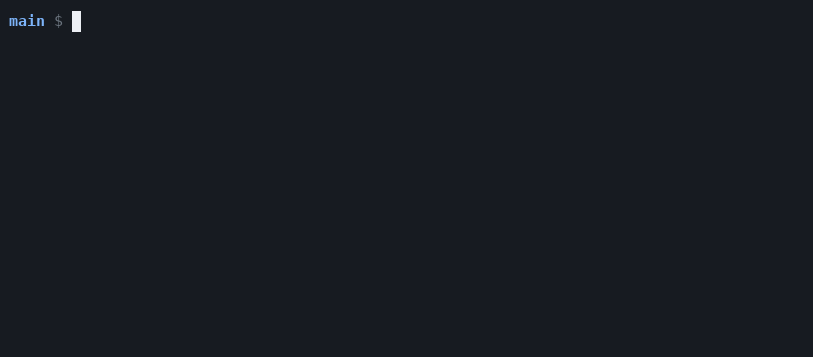
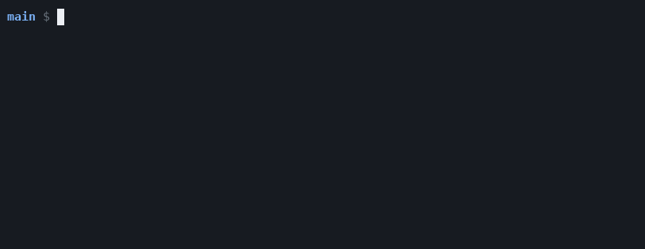
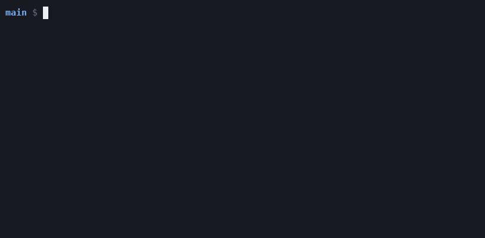

<h1 align="center">Layr</h1>

<p align="center">
  <b>Version control that snapshots folders, not files.</b><br>
  Every line of work is a real folder. Every save is an instant, read-only copy of it.<br>
  Every step, by a person, a script or an AI agent, can be undone.
</p>

<p align="center">
  
  
  
</p>

```console
$ layr line new fix                # a new working folder, ready in milliseconds
$ cd ../fix && vim src/parser.rs
$ layr save -am "Fix the parser"   # freeze the folder as a state
$ rm -rf src                       # a mistake: yours, or an AI agent's
$ layr restore .                   # and it is back
```

## Why Layr

Git was built for one person, one working copy, and files that change by hand. Today a project
has a dozen agents working at once, each with its own folder, its own build cache, and shell
commands that change files behind the editor's back. Layr is built for that.

- **Parallel work is cheap.** A new line is a file system snapshot: constant time, no copy, the
  build cache comes along. 16 lines with 128 MiB caches take **153 MiB** in Layr and
  **2,508 MiB** as Git worktrees ([measured](docs/performance.md)).
- **Nothing gets lost.** Layr snapshots the folder itself, so it sees what `rm -rf`, `sed -i` or a
  code generator did. Every operation is a signed record, and `layr undo` reverses it.
- **You ship what you checked.** Checks, approvals and deploys name one exact state. Change one
  byte and the approval no longer applies. A merge queue keeps `main` green.
- **Secrets are versioned and pushed securely.** `.env` files and keys live in private overlays:
  their own history, their own readers, their own encryption key. They travel with every push,
  and only the people and machines you allow can open them. Layr refuses any save or push that
  would copy a secret's value into shared files.
- **Copies are encrypted and yours.** Push to a peer, a folder, your own S3 bucket or Layr Cloud.
  Data is encrypted end to end with `age` before it leaves the machine: storage and cloud see
  ciphertext only.
- **Sharing is per person.** One person key opens every project that person may read. Grant it
  with one command; nobody else, the cloud included, ever holds the key.

## See it

Real commands and their real output, recorded on Linux with btrfs.

**A mistake is one command away from undone.** Delete a folder, then bring it back:



**Sixteen agents, sixteen folders, a fraction of a second.**



**Production takes only what passed.** The ref refuses until the exact state has a passing check:



**Secrets stay private, and still travel.** The token lives in an overlay. Copying its value into
shared code is refused, and the push stores the overlay encrypted:


## How it works

Layr has five ideas. Everything else is built from them.

```text
  line   main/              a real folder you work in
           │ save
           ▼
  state  7d3e               a frozen, read-only copy of that folder
           ▲        ▲
           │        └─ attestation   a signed note about one state: "tests passed", "approved"
           └────────── ref           a name for a state: env/prod, release/1.4.2

  remote                    another place with the same states: a peer, a folder, S3, Layr Cloud
```

Lines and states are btrfs subvolumes and snapshots, so creating one costs the same for ten files
or ten million. Changes between states come from file system metadata in time proportional to
the change, not to the project. A root service performs every operation, checks who asks, and
signs a record for it. The [design document](docs/design.md) explains each choice.

## Install

```sh
cargo install --git https://github.com/ifdotpy/layr layr
```

| Platform | Store on | Notes |
|---|---|---|
| Linux | btrfs (a loop file works) | Needs `btrfs-progs`, `git`, `zstd`. Run the service with systemd ([Linux service](#linux-service)) |
| macOS | any APFS folder, also on the default volume | Set `LAYR_ROOT` to a folder, for example `~/Projects/layr-store`. Commands run as you; the root service is optional ([details](docs/apfs.md)) |
| Linux | ext4 or XFS, through OverlayFS | Build with `--features overlayfs`; needs root mount permission ([details](docs/overlayfs-backend.md)) |

All three keep the same store and record formats, so machines on different platforms sync with
each other.

### Linux service

Install the root service unit (it runs `layr daemon` as root):

```sh
sudo install -m 0755 "$(command -v layr)" /usr/local/bin/layr
sudo install -m 0644 packaging/systemd/layr.service /etc/systemd/system/layr.service
sudo systemctl daemon-reload
sudo systemctl enable --now layr
```

The unit has `RequiresMountsFor=/var/lib/layr`. Keep it when the store is a separate mount: systemd
then waits for that mount before it starts layr.

layr refuses a store that sits in the root subvolume, because a system snapshot rollback would
empty it. Put the store in its own subvolume: [Btrfs root snapshots](docs/btrfs-root-snapshots.md).

## Quick start

```sh
sudo layr init app --from ~/src/app --owner alice     # import a folder; main is protected
cd /var/lib/layr/projects/app/lines/main
layr line new topic                                     # a new line next to main
cd ../topic && $EDITOR src/lib.rs
layr status && layr diff
layr save -am "Fix the parser"                          # a new state
cd ../main
layr merge topic --expect "$(layr rev-parse topic)"     # exactly the state you reviewed
layr git push origin main                               # mirror to GitHub when you want
```

## If you know Git

| Git | Layr | Difference |
|---|---|---|
| branch + worktree | **line** | One thing: a line is its own folder, with its own caches |
| commit | **state** (`layr save -m`) | A snapshot of the whole folder, signed by the machine |
| `HEAD` | `head` | |
| `git stash` | `layr park` | |
| `cherry-pick`, `rebase`, `revert` | `pick`, `replay`, `invert` | Conflicts never stop the operation; they are part of the new state |
| tag | **ref** | Moves only with compare-and-swap (`--expect`), keeps its history (`env/prod@{1}`) |
| CI status, PR approval | **attestation** | Signed, stored with the state, bound to its exact content |
| reflog | `layr op log`, `layr undo` | Covers every operation, not only branch moves |

`diff`, `status --porcelain`, `show` and `log --format` print Git's formats byte for byte, so
editors and tools that read Git output keep working.

## A tour

| | |
|---|---|
| **Undo what an agent did** | `layr op log`, `layr undo`, `layr restore --source <state> .` ([review](docs/review.md)) |
| **Run many agents at once** | `layr line new agent main --count 16`: separate folders, shared warm caches |
| **See conflicts before merging** | `layr status` lists files that other live lines change too |
| **Merge lockfiles by rebuilding them** | `package-lock.json derive=npm` in `.layrattributes` ([merge](docs/merge.md)) |
| **Find the step that broke it** | `layr bisect run --auto -- cargo test` searches every saved step, not only states with messages |
| **Review versions of one change** | `layr change show`, `layr change diff --from v2 --to v3`: a change keeps its id through amends and replays |
| **Review behavior** | `layr probe run`, `layr probe diff` compare API answers, metrics and files between exact states |
| **Sign what happened** | `layr attest`, `layr approve`, `layr try`: signed checks and approvals bound to exact states |
| **Keep `main` green** | `layr queue add`, `layr queue run`: merges only after checks pass on the exact result |
| **Protect production** | `layr protect env/prod --check unit --approvals 1`, `layr ref set env/prod … --expect`, rollback with `env/prod@{1}` |
| **Run any ref as a container** | images and Helm charts from `layr.toml`, served by the daemon: `docker pull <host>/shop/app:prod` ([OCI](docs/oci.md)) |
| **Version secrets** | private overlays with their own readers and keys; a detector stops secret values in shared files ([overlays](docs/overlays.md)) |
| **Stack layers into views** | `layr view`: shared files plus overlays as one addressable stack, `views/<id>` |
| **Keep encrypted copies** | `layr remote add vault s3://bucket/app`, `layr push vault`, `layr clone`, `layr mount vault` ([remotes](docs/remotes.md)) |
| **Share with people** | `layr person keys`, `layr remote grant vault --person alice --recipient age1…` |
| **Sync your own machines** | `layr remote add laptop ssh://laptop/app`, `layr sync laptop` |
| **Move from Layr Desk** | `layr clone s3://desk-bucket/project` imports a Desk vault with its signatures checked |
| **Mirror to Git** | `layr git push origin main`: every state becomes a Git commit with the same parents |

## Status

Layr is **alpha**. The btrfs backend is the supported one and has an integration suite of more
than a thousand checks that runs on real btrfs file systems; the core commands also run on APFS.
The store format and command names may still change. There has been no external security audit.
See [what this version does not do](docs/limits.md).

## Layr Cloud

[Layr Cloud](https://github.com/ifdotpy/layr-cloud) runs Layr in your own AWS account:

- an end-to-end encrypted S3 store per project, in an account you own;
- a gateway, so machines and people reach stores without AWS credentials (`layr+https://`);
- person keys, invites and pins, so one key opens every project a person may read;
- an executor host that runs the merge queue, the checks and the container registry;
- CloudFormation templates and a runbook; no operator ever holds your keys.

Layr talks to it as an ordinary remote.

## Documentation

[Commands](docs/commands.md) ·
[Btrfs root snapshots](docs/btrfs-root-snapshots.md) ·
[Review and delivery](docs/review.md) ·
[Merging](docs/merge.md) ·
[Remotes](docs/remotes.md) ·
[Containers](docs/oci.md) ·
[Overlays](docs/overlays.md) ·
[Security](docs/security.md) ·
[Performance](docs/performance.md) ·
[Design](docs/design.md)

## Contributing

```sh
cargo test --workspace      # unit tests
sudo tests/run.sh           # integration tests: each file gets a fresh btrfs on a loop file
```

Unsafe code is limited to `src/sys.rs`. Commit messages say what changed and why, in plain words.

## License

[MIT](LICENSE)
