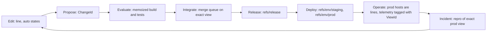

# Layr Ecosystem, Layr Cloud и Chromium — архитектурный RFC

**Версия:** 0.9 · **Дата:** 22 октября 2026 года (0.2: 18 октября; 0.5 объединяет RFC и дополнение «Chromium, Derived State и Core API»; 0.6 сводит модель к пяти сущностям, 3.0; 0.7 возвращает `age` для объектов, 6.3; 0.8 добавляет часть III: DevOps, runnable view, OCI как remote; 0.9 фиксирует имена новых команд, 12.6) · **Статус:** design proposal, не утверждённая спецификация  
**Область:** Layr (version control), LAYR Studio (агенты), Layr Desk (E2EE S3-архив) и потенциальный Layr Cloud (remote, reviews, compute, environments); часть II: Chromium, derived state и Core API.  
**Язык:** русский; имена API и терминов сохранены по-английски.

> **Главный тезис.** Не нужно переписывать Layr как новую ФС, чтобы создать новый класс продукта. Практический путь — сохранить native Btrfs/APFS workspaces, использовать Layr Desk для экономного холодного хранения и построить поверх них Cloud с первым классом объектов **State**, **View**, **Execution** и **Review**. Полностью виртуальная compositional MVCC-файловая система остаётся экспериментальным направлением на случай, если цена материализации произвольных слоёв станет доказанным ограничением.

## Содержание

1. [Исходные факты, статусы и границы](#1-исходные-факты-статусы-и-границы)
2. [Продуктовая гипотеза](#2-продуктовая-гипотеза)
3. [Модель состояний и слоёв](#3-модель-состояний-и-слоёв)
4. [Новая вычислительная модель: композиция, транзакции, интеграция](#4-новая-вычислительная-модель-композиция-транзакции-интеграция)
5. [Layr Cloud: подсистемы и пользовательский опыт](#5-layr-cloud-подсистемы-и-пользовательский-опыт)
6. [Cloud storage: S3-first](#6-cloud-storage-s3-first)
7. [Шифрование, секреты, доступ и ротация](#7-шифрование-секреты-доступ-и-ротация)
8. [AWS-архитектура и экономика](#8-aws-архитектура-и-экономика)
9. [Существующий софт: базы, компиляторы, кэши](#9-существующий-софт-базы-компиляторы-кэши)
10. [Performance baseline и целевые гипотезы](#10-performance-baseline-и-целевые-гипотезы)
11. [Альтернатива: нативная виртуальная MVCC-ФС](#11-альтернатива-нативная-виртуальная-mvcc-фс)
12. [API, протоколы и инварианты](#12-api-протоколы-и-инварианты)
13. [Roadmap и экспериментальная программа](#13-roadmap-и-экспериментальная-программа)
14. [Риски, нерешённые решения и критерии отказа](#14-риски-нерешённые-решения-и-критерии-отказа)

**Часть II. Chromium, Derived State и Core API**

15. Часть II: Chromium, Derived State и Core API
16. Chromium как основной use case
17. Инвалидация кэшей
18. Promotion: как повышать кэш агента до общего
19. Универсальная модель Versioned Derived State
20. Предлагаемый Core API: дополнение к существующим примитивам
21. Разделение ответственности: что точно вне Core
22. Какие внешние программы адаптировать к Layr
23. Контракты безопасности кэша
24. Benchmark plan: решение о разработке по цифрам
25. Предлагаемый минимальный roadmap
26. Рекомендации по модульности репозитория
27. Открытые решения и вопросы перед кодом
28. Итоговое техническое решение

**Часть III. DevOps на Layr**

29. Цикл DevOps на Layr
30. Runnable view
31. OCI как remote

32. [Источники](#32-источники)

---

## 1. Исходные факты, статусы и границы

Ниже **[СУЩ]** — то, что описано или продемонстрировано в текущих репозиториях; **[ПРЕДЛ]** — предложение этого RFC; **[ГИПОТЕЗА]** — оценка, которую надо проверить экспериментально; **[ИНТЕГРАЦИЯ]** — поведение специализированного инструмента вне Layr Core. Наличие кода или бенчмарка не равно production-readiness.

### 1.1. Layr [СУЩ]

- Version control на Btrfs: `line` — writable snapshot, `state` — read-only snapshot плюс подписанная запись, diff/status основаны на metadata-send; merge использует reflinks. Есть Git bridge, операции с ролями, защита веток, auto states, копия проекта в папку с восстановлением, peer sync.
- Оверлеи: отдельные истории файлов с собственными readers; `shared` видим всем читателям проекта, другие слои видимы их readers. Рабочая директория остаётся **обычным writable Btrfs subvolume**, слои физически собираются при смене stack; это **не OverlayFS**.
- Кэши (`regenerable`): nested subvolumes вне основной истории, diff и копий проекта. Новая линия может получить reflink-копию прогретого кэша ближайшего предка. Явное сохранение через `layr save --caches`.
- Backends: btrfs на Linux поддерживается; OverlayFS (ext4/XFS) и APFS (macOS) экспериментальные. Форматы store и signed record совместимы между backends (`README.md`). Полного паритета у экспериментальных backends нет. Поэтому формат remote не должен зависеть от backend.
- Signed record сейчас подписывает ключ машины. `Author.session` является свободным текстом из `LAYR_SESSION`: Layr его показывает, но не проверяет (`src/model.rs`).
- Текущие ограничения overlays: нет полной реализации route-patterns, полноценного составного идентификатора stack для approvals, encryption/replication приватных overlays и некоторых режимов из дизайн-документа. Нужно сверять статус с конкретным коммитом перед разработкой.

### 1.2. LAYR Studio / codex-studio [СУЩ]

- Desktop orchestration для lead agent и workers, Codex app-server, сообщения агентов, durable operations, monitors, UI. Существуют документы об изоляции рабочих пространств в Linux VM, `host_exec`, переносе/переиспользовании caches и запуске macOS build tools.
- Система оркестрации уже закрывает часть будущего продукта «Layr Agents»; Cloud должен **переиспользовать**, а не дублировать её contracts и процессы.
- Полноценные cloud database branches, общий реестр совместимых кэшей и согласованный snapshot `code + DB + cache` не следует считать реализованными без отдельной проверки.

### 1.3. Layr Desk [СУЩ]

- S3 vault в AWS-аккаунте владельца, E2EE `age`, web reader и read-only network disk; writer передаёт file/tree deltas. Текущая схема: один основной линейный поток состояний и vault key, предоставляемый через зашифрованные slots.
- В `docs/design.md` зафиксированы: canonical tree JSON; full tree как минимум каждые 32 states; file-delta chain максимум 16; delta для файлов до 32 MiB; zstd level 3; data parts до 16 MiB (более крупная frame в отдельном объекте); сначала upload data parts, последним — tree object.
- Writer сейчас опирается на `layr export` соседних состояний и `layr diff`; это важно для стоимости push на больших проектах.
- История из 1 095 states: **100.8 MB** для `btrfs send + zstd`, **25.7 MB** для file+tree deltas с zstd-3, **23.9 MB** для file+tree deltas с zstd-19, **23.9 MB** для Git aggressive; это один эксперимент, не универсальное соотношение.
- В документации перечислены известные ограничения, включая rollback без доверенного checkpoint, риски доставки произвольного JavaScript browser-reader, отсутствующий полноценный GC и модель vault-wide grants.

### 1.4. Главное разделение ответственности [ПРЕДЛ]

| Подсистема | Что является истиной | Что выполняет |
|---|---|---|
| Layr Engine | Локальные states, lines, overlays, signed records | Version control + native POSIX workspace |
| LAYR Studio | Сессии, задания, результаты и оркестрация агентов | Разработка и локальное выполнение |
| Layr Storage (из Desk) | Immutable encrypted objects/manifests | Долговременная история в S3 |
| Layr Cloud Control Plane | ACL, refs, reviews, executions, indexes, billing | Координация и публикация |
| Layr Compute | Временный Btrfs/NVMe cache и process/VM isolation | Build/test/agent/preview |

**Инвариант:** долговременный опубликованный state восстанавливается без сохранения конкретного EC2 worker; локальный Btrfs — производная копия, не единственный источник истины.

### 1.5. Граница Layr и агентов [РЕШЕНО]

В Layr нет терминов агентов и Studio. Layr знает только states, lines, overlays, caches, refs и права. «Layr Agents» (2.1) является частью Studio. Studio использует только публичный CLI и API Layr и не получает внутренних hooks. Любая агентская функция, которой нужен новый примитив Layr, сначала описывает этот примитив в общих терминах.

### 1.6. Горячая копия на Mac [РЕШЕНО]

Основной путь: Btrfs внутри Linux VM на Mac. Это та же модель, что у облачных workers, и Layr там уже работает. Studio уже так работает.

APFS используется только для сборок, которым нужен Mac (Xcode, Swift, codesign, симуляторы). Они идут через Studio `host_exec` и стабильные build slots. APFS backend Layr остаётся экспериментальным. Полного паритета с Btrfs для него не требуется, пока такой сборке не нужна история или overlays на стороне Mac.

**Открытый вопрос (0.3):** текущая работа в Layr идёт в APFS backend. С `dea8205` до `ef7b637` 13 из 37 commits относятся к APFS (ветка `perf/apfs-features`). Нужно решить одно из двух: изменить это решение или ограничить работу над APFS сборками для Mac. См. 14.1.

---

## 2. Продуктовая гипотеза

**Не делать просто «GitHub, но вместо Git — Btrfs».** Такая замена сама по себе не снимает миграционные издержки. Цель — система, где объектом ревью и выполнения является **воспроизводимое состояние проекта**, а не только patch/commit.

### 2.1. Продуктовые компоненты [ПРЕДЛ]

1. **Layr Repos** — native remote, история состояний, код и файловый web UI, Git mirror для совместимости.
2. **Layr Reviews** — review точного составного state, approvals/checks, provenance, возможность fork/execution из ревью. Review не должен незаметно переживать изменение любого входного слоя.
3. **Layr Agents** — часть Studio, не Layr (1.5); интеграция через публичный CLI и API Layr; множество агентов создают независимые states и checkpoints; облачный worker — необязательный способ запуска.
4. **Layr Compute** — CI и тесты, которые получают заранее подготовленные state и persistent caches, а не «checkout + install с нуля».
5. **Layr Environments** — версионирование согласованного набора `code + config + cache descriptor + data snapshot + runtime description`.
6. **Layr Cloud Storage / Desk** — E2EE копии проекта, preview файлов, холодная история, key grants и BYO bucket.
7. **Layr Merge Queue** — очередь merge в защищённую линию: Layr собирает `main + A + B`, проверяет точный view и двигает ref только после проверки. `main` всегда проходит проверки. Подбор комбинаций (Integration Planner) остаётся исследованием этапа 5.

### 2.2. Отличительная UX-операция

**Executable Review**: карточка ревью содержит `ChangeId`, `StateId`, versioned environment descriptor, результат CI, attestations (12.5), доступный preview и команды `Fork`, `Reproduce`, `Inspect failure`, `Approve exact state`, `Merge if expected head`. По `ChangeId` ревью показывает разницу между версиями одного изменения (interdiff).

Это не означает, что сама файловая система автоматически сохраняет RAM, контейнеры, PostgreSQL или внешние сервисы. Такой review будет воспроизводимым **только после того, как каждый компонент предоставит корректный механизм checkpoint/recreate**.

### 2.3. Git coexistence, не forced migration

- Двусторонний Git bridge; push в GitHub как mirror только **разрешённой shared-проекции**.
- Public Git commits не обязаны включать private overlays, build caches, test DB, secrets.
- Сохранять оригинальные Git hashes для совместимых деревьев, где это возможно.
- GitHub Actions/PR link временно поддерживаются; облачный Layr remote включается постепенно.

### 2.4. Монетизация [ГИПОТЕЗА]

Не продавать только storage repository. Продавать:
- хранение физически уникальных encrypted bytes и retention;
- compute для agents/CI/previews;
- prepared environments и гарантии восстановления;
- enterprise governance / approvals / SSO / audit / BYO AWS.

Ключевой KPI — **стоимость полученного и проверенного изменения**, а не только число tokens или время операции `branch`.

### 2.5. Где Layr может дать больше всего пользы [ГИПОТЕЗА]

Метка «основа есть» значит, что нужные примитивы уже есть в Layr. Это не значит, что сценарий готов.

1. **Среды для оценки и обучения (RL) coding-агентов.** Тысячи запусков агента от одного точного состояния, каждый с чистой копией и тёплыми caches; результат каждого запуска является state для diff и сравнения. Сейчас для этого используют `git clean`, Docker layers или копирование. Основа есть: `branch` (180–280 ms на 200 000 files, 10.1), caches, `diff`.
2. **Best-of-N.** N агентов решают одну задачу от одного state, checks выбирают лучший результат, merge queue (фаза 2D) вливает его. Замер: 16 веток с приватными caches занимают 153 MiB против 2508 MiB у Git с полными копиями (10.1). Основа есть; выбор результата делает Studio.
3. **Машина времени для сессии агента.** Каждый tool call является state (5.5). `bisect` по auto states находит вызов, который сломал сборку; сессию можно повторить с любого шага. Основа есть: `save`, `diff`, `undo`. Команды `bisect` нет.
4. **Безопасный запуск опасных команд.** Миграции, `npm install`, codemods и удаление файлов агент выполняет в `layr try`; результат применяется только после checks. Основа есть: `try <state> -- <cmd>`.
5. **Готовое рабочее место за секунды.** Новый человек или агент получает рабочую папку с собранными caches и зависимостями. Основа есть локально (reflink caches, `save --caches`); для другой машины нужен remote (этап 1).
6. **Изоляция секретов от агента.** Line агента не содержит private layers: prompt injection не может прочитать то, чего нет на диске. Основа есть: overlays и readers. Нужно правило «line агента без private layers».
7. **Точное воспроизведение сбоя.** При ошибке CI или агента сохраняется точный state, включая неотслеживаемые файлы и caches; разработчик открывает именно эту папку. Помогает с flaky tests. Основа есть: `save`, `try`.
8. **Конфигурация машин.** Версии `/etc`, home и конфигураций сервисов с подписанными records, ролями и `undo`. Ближайший аналог: snapper на Btrfs, у него нет ролей и подписей.
9. **Большие бинарные проекты** (game dev, CAD, ML datasets), где Git не подходит и используют Perforce. CoW даёт дешёвые ветки для больших файлов. Пробелы: нет file locking, который обязателен для бинарных assets; формат remote для больших файлов не определён (6.2).

### 2.6. Проблемы индустрии и ответ Layr [ГИПОТЕЗА, источники в 32]

Проверено поиском 22.10.2026. Многие цифры взяты из блогов поставщиков; это отмечено.

| Проблема | Факт | Что даёт Layr | Чего не хватает |
|---|---|---|---|
| Checkpoints агента не видят shell | Docs Claude Code: «Checkpointing does not track files modified by bash commands». Checkpoints Cursor не включают файлы из `.gitignore` | Save на уровне ФС видит любое изменение (5.5). История в root service; агент без root её не удалит (`docs/design.md` §2) | Hook в Studio |
| Параллельные worktrees дороги | `node_modules` и `.env` не переносятся; пример 9.82 GB за 20 минут на базе около 2 GB (единичный случай) | Reflink caches: 16 веток 153 MiB против 2508 MiB у Git (10.1) | Нет |
| Секреты | GitGuardian 2026: 28.65 млн новых секретов в публичных commits за 2025; commits с Claude Code 3.2% против 1.5% базы. Prompt injection прочитал `.env`, который был в `.gitignore` | Private overlay отсутствует в line агента (2.5, пункт 6) | Правило «line агента без private layers» |
| Агент удаляет данные | Replit, июль 2025: удалена рабочая база во время code freeze. Neon: более 80% баз создают агенты (цифра Databricks) | `try`, ветки баз (этап 4) | Адаптеры баз |
| Ревью не успевает | Оценка: 17 млн PR агентов в месяц; PR от AI ждут ревьюера в 4.6 раза дольше (LinearB, через блог) | Ревью точного state, diff каждого tool call, merge queue до человека | Чтение кода человеком остаётся |
| Сломанный `main` | Семантический конфликт: два PR проходят CI по отдельности и ломают `main` вместе; «branch up to date» даёт бесконечные rebase | Merge queue на точном view, повтор checks по `ExecutionKey` (фаза 2D) | Нет |
| Кэш CI | GitHub Actions: 10 GB на репозиторий, 7 дней, LRU раз в час, предупреждение о cache thrashing; 98.5% организаций используют checkout по умолчанию (Depot) | CI берёт state с тёплыми caches вместо checkout и install | Remote (этап 1) |
| Flaky tests | Atlassian: около 150 000 часов в год; Google: 84% переходов pass→fail связаны с flaky tests | Точный state сбоя для повтора | Flakiness Layr не лечит |
| Монорепозитории | TikTok: clone 23 минуты, `status` 7 секунд до Sparo | Локально `status` около 20 ms на 200 000 файлов, branch 180–280 ms (10.1) | Первый clone платит за передачу |
| Большие бинарные файлы | Git плохо подходит для assets; сильных данных о переходе с Perforce не найдено | CoW для больших файлов | File locking, формат remote для больших файлов |
| Sandboxes и RL environments | E2B: fork до 20 копий за вызов; Morph продаёт snapshot и branch. TechCrunch: руководители Anthropic обсуждали более $1 млрд на RL environments | Fork ФС с тёплыми caches дешевле snapshot VM | Память процессов не сохраняется: Layr дополняет sandbox |

---

## 3. Модель состояний и слоёв

### 3.0. Пять сущностей ядра [ПРЕДЛ]

Вся модель Layr и Cloud строится из пяти сущностей. Другие понятия RFC являются их частными случаями.

1. **State:** неизменяемое дерево. Поля: `kind`, `parents`, `change_id`. Для `kind = cache` и `kind = derived` также `derived_from` (исходный state) и `context` (непрозрачный для Layr идентификатор контекста от adapter).
2. **Ref:** изменяемый указатель на state с CAS. Может иметь TTL. Имя ref задаёт его роль по префиксу.
3. **Attestation:** подписанное утверждение о state или view (12.5).
4. **View:** упорядоченный список states. Каждый слой, кэш и окружение является state в этом списке.
5. **Remote:** другое место хранения тех же states, refs и attestations (12.4).

Кроме них есть два значения без собственного жизненного цикла: `ChangeId` (поле state) и `ExecutionKey` (ключ кэша, 5.4).

| Прежнее понятие | Теперь |
|---|---|
| `CacheSnapshotId`, `DerivedStateId`, набор `ArtifactId` | State с `kind = cache` или `kind = derived` |
| `ArtifactKey`, `artifact.resolve` | Ref `refs/derived/<context>/<key>` на state `kind = derived` |
| `cache.promote`, `artifact.promote`, `ref.compare_exchange` | Один CAS на ref, например `refs/caches/<context>/main` |
| `Namespace` | Префикс имени ref и ACL на этот префикс |
| `PinId`, `LeaseId`, retention pins, legal holds | Ref с TTL: `refs/pins/…`, `refs/leases/…`, `refs/holds/…` |
| `ExecutionRecord`, `ValidationId`, approval, quarantine | Attestation: `check`, `approval`, `quarantine` |
| `TxId`, `transaction.begin/prepare/commit` | Загрузка неизменяемых объектов, затем CAS ref (6.5); для нескольких refs `refs/head.json` |
| `EnvironmentId`, environment descriptor | State-слой во View |
| `WorkspaceId` | Line (существует в Layr) |
| `events.subscribe` | Курсор по существующему `op log` |
| Replication API (`object.put`, `state.pack`, `replica.push`) | `push` и `pull` для remote |

**Правила, которые сохраняют возможности:**
- State `kind = cache` и `kind = derived` не входит в историю line, diff, merge и Git export. Это текущее поведение regenerable caches (1.1).
- Ref с TTL удаляется после срока; пока он жив, его state является корнем GC. Отдельного механизма pins и leases нет.
- Leases меняются часто. В S3 каждое продление является PUT, поэтому leases хранит локальный Layr или control plane, а в S3 попадают только pins и holds.
- Action results сборки Chromium хранит сервер REAPI (27, вопрос 3), а не Layr. Layr хранит целые деревья кэша как states.

### 3.1. Композиционное состояние [ПРЕДЛ]

```
View = compose(ordered_states)
```

`ViewId` является каноническим хешем упорядоченного списка `StateId` вместе с путями монтирования и правилами разрешения конфликтов. Shared code, overlays, кэши и окружение входят в список как states. Порядок важен.

Политика доступа **не входит** в `ViewId`. Иначе любая смена ACL меняет identity содержимого и делает недействительными все reviews, проверки и кэши этого view. Hash identity не заменяет авторизацию: ACL проверяется отдельно при каждом доступе и при создании view. Review хранит пару (`ViewId`, версия политики на момент approve). После смены политики review остаётся. Повторная проверка нужна только для читателей, которые потеряли доступ к одному из слоёв.

Важно различать:
- `StateId`: immutable snapshot одного слоя/дерева (или идентификатор записанной операции в существующем Layr). `kind` различает commit, auto, stash, import, cache и derived.
- `ChangeId`: стабильный идентификатор логического изменения. Он не меняется после `commit --amend`, rebase и merge с новым `main`; новая версия изменения получает новый `StateId` с тем же `ChangeId`. Так ревью, обсуждения и attestations связывают версии одного изменения. Пример: Jujutsu и Gerrit Change-Id. `ChangeId` записан в manifest state (6.4), но не заменяет точный `ViewId` в approval.
- `ViewId`: комбинация версий, порядка слоёв и правил разрешения конфликтов.
- Line: mutable рабочая папка, привязанная к одному view и имеющая собственные изменения (прежнее имя в RFC: `WorkspaceId`).
- `ExecutionKey`: хеш входов запуска (input ViewId, toolchain image digest, commands, declared inputs). Это ключ кэша результатов, как action key в Bazel. Он не доказывает повторяемость.
- Результат одного запуска: attestation `kind = check` (12.5). Payload содержит `ExecutionKey`, outputs, logs и worker. Отдельного типа `ExecutionRecord` нет.

### 3.2. Защита private overlays

- Новые файлы, похожие на секреты, направлять в private layer через **path policies**, а не рассчитывать на `.gitignore`.
- Rename/move приватного файла **не должен** неявно делать его shared. Ownership желательно связывать с inode/object lineage и explicit declassification, а не только с путём.
- При конфликте одинаковых путей нужен детерминированный precedence или явный конфликт; при удалении overlay-файла — **whiteout/tombstone**, иначе нижний секрет может вновь стать видимым.
- Автоматические snapshots сборного дерева опасны, поскольку содержат private data; доступ к ним ограничивать читателями всех включённых слоёв либо хранить snapshots раздельно.
- Политика на «secrets в shared» должна быть консервативной, с explicit approve/export boundary и audit.

### 3.3. Два алгоритма композиции

**Практический / сейчас:** собрать одно POSIX-дерево через Btrfs snapshot/reflink. Это быстрее всего для обычных программ, хорошо использует VFS/page cache, но время композиции растёт с числом overlay files при разном stack.

**Радикальный / будущий:** хранить persistent trees с references, lazily resolve paths, не материализовать дерево до обращения. Ускоряет изменение набора слоёв, но добавляет runtime lookup/readdir overhead, усложняет mmap, hardlinks, rename, ACL и crash consistency.

**Решение на сегодня:** не менять backend Layr, пока энд-ту-энд бенчмарк не покажет явный bottleneck именно assembly.

---

## 4. Новая вычислительная модель: композиция, транзакции, интеграция

### 4.1. Многомерные версии [ПРЕДЛ]

Независимо версионировать shared code, private settings, dev secrets, test data, build cache, deployment config и ML artifacts. Теоретически `10` слоёв по `10` версий создают `10^10` **адресуемых** сочетаний, но не бесплатную возможность их выполнить или проверить. Ни один из них не обязан быть полноценной физической копией до исполнения.

### 4.2. Транзакционность [ПРЕДЛ]

Опубликованный state должен иметь:
- immutable inputs и signed manifest;
- snapshot isolation для читающего/тестирующего процесса;
- optimistic concurrency и CAS для обновления branch refs;
- атомарную публикацию **логического manifest** набора слоёв;
- декларацию write/read sets по возможности и explicit conflict resolution;
- повторяемость операций после crash с idempotency keys.

Одна атомарная запись manifest ≠ распределённая транзакция с PostgreSQL, S3, external APIs или рантаймом агента. Согласованный DB checkpoint требует собственного протокола.

### 4.3. Integration before merge [ПРЕДЛ]

Для N результатов агентов:
1. построить граф overlap/rename/semantic dependencies;
2. сформировать совместимые подмножества;
3. временно compose каждую выбранную комбинацию;
4. выполнить checks именно на composite ViewId;
5. представить approval + proof/execution result;
6. опубликовать с `expected_head` (иначе новый цикл проверки).

Даже если файлы не пересекаются, семантический конфликт возможен. `ConflictGraph` должен различать **syntactic conflicts**, **suspected semantic dependencies** и **test-confirmed failures**. Не обещать автоматическую семантическую корректность по одному файловому diff.

### 4.4. История как query engine [ПРЕДЛ]

Версионируемые queryable entities: `states`, `views`, `files`, `changed_paths`, `executions`, `test_results`, `agent_provenance`, `approvals`. Примеры: найти состояние с изменением `auth.rs`, прошедшим security tests; найти последнюю совместимую комбинацию A+B без C. Запросы выполняются по индексам Cloud, а не через полное восстановление Btrfs.

### 4.5. Пространство состояний для AI software factory

Вместо потока «агент → Git commit → PR → CI»:

```text
Base state ──┬── Agent A → State A ──┐
             ├── Agent B → State B ──┼── Compose/Validate ── Review/Publish
             └── Agent C → State C ──┘
                  │                     │
                  └── checkpoints       └── exact execution results
```

Идея: сначала вычислить совместимые комбинации, затем закрепить результат. Переиспользовать проверки уже рассчитанных exact ViewId (окружение входит в view, 3.0).

### 4.6. Производные файлы: перегенерация вместо merge [ПРЕДЛ]

**Проблема.** Lockfiles (`package-lock.json`, `Cargo.lock`, `pnpm-lock.yaml`), generated code и snapshots тестов являются функцией других файлов. Построчный merge таких файлов даёт бессмысленные конфликты. Хуже: если обе стороны изменили `package.json`, а lockfile только одна, merge без конфликта берёт lockfile этой стороны. Он не совпадает со слитым `package.json`, и ошибки нет.

**Что есть сейчас [СУЩ].** Command driver (`merge.driver.<name>`, `src/merge.rs:606`) получает три версии **одного** файла, как в git. Он не видит слитое дерево и запускается только при изменении файла на обеих сторонах.

**Решение.** Новый шаг после merge всего дерева:
- `.layrattributes`: `package-lock.json derive=npm`.
- Config проекта: `derive.command.npm = "npm install --package-lock-only"` и `derive.inputs.npm = "package.json"`. Атрибут только называет правило; команду задаёт config, поэтому файл чужого репозитория не может подложить команду (как у merge drivers сейчас).
- Layr запускает команду в слитом дереве, если на любой стороне изменился вход или сам производный файл. Построчный merge производного файла не выполняется.
- Команда работает как вызывающий пользователь, в приватной копии, по тем же правилам, что command drivers и `merge-verify`.
- Если команда завершилась ошибкой: конфликт в state, производный файл остаётся версии ours (как при ошибке `merge-verify`).
- То же правило работает в rebase, cherry-pick и merge queue (фаза 2D).

**Открытые вопросы:**
- Сеть: `npm install --package-lock-only` обращается к registry. Нужно правило для сети и кэша registry.
- Детерминизм: одинаковые входы должны давать одинаковый файл. Иначе две стороны merge дают разные результаты; проверка: повторный запуск даёт тот же digest.
- Порядок: несколько правил derive, где выход одного является входом другого.

### 4.7. Детектор утечки секретов по точному значению [ПРЕДЛ]

**Идея.** Layr знает реальные значения секретов: они лежат в private layers (7.1). При commit в shared layer и при Git export Layr ищет эти значения в добавленных строках diff. Сканеры по шаблонам (gitleaks, GitGuardian) не знают значений проекта; Layr ищет только реальные секреты этого проекта.

**Дизайн:**
- Root service выделяет из файлов private layers значения-кандидаты (например, значения строк `.env`) длиной не меньше порога, чтобы не ловить `true` и `8080`.
- Индекс хранит только `HMAC(K_index, значение)`, а не сами значения. Вторая копия секретов не появляется.
- Добавленные строки diff режутся на токены; HMAC токена сравнивается с индексом.
- Совпадение: commit в shared layer и Git export отклоняются с указанием файла и строки, без показа значения. Для явного declassification нужна attestation `approval` (12.5).

**Ограничения:** закодированный или разрезанный секрет (атака GhostCommit записала секрет числами) поиск не находит. Это дополнительная защита, не замена изоляции private layers (2.5, пункт 6).

### 4.8. Радар конфликтов между live lines [ПРЕДЛ]

**Идея.** Все lines агентов проекта находятся на одной машине или в одном remote. После каждого save Layr сравнивает пути, изменённые относительно общей базы, между живыми lines. Если две lines меняют один файл, Layr сообщает об этом сразу, а не при merge. Git этого не делает: каждая ветка живёт в своём clone.

**Дизайн:**
- Источник: change lists за O(changes) (`btrfs send --no-data`, 1.1), которые Layr уже строит для status и diff.
- Результат: запись в `op log` и событие для потребителя (Studio). Layr не решает, что делать; Studio может предупредить агента или поменять порядок merge queue.
- Видимость: line видит пересечение только по путям, которые читатель может читать в обеих lines. Пути private layers не раскрываются.
- Уровень: сначала путь файла. Пересечение по диапазонам строк можно добавить позже по замерам ложных срабатываний.

### 4.9. `bisect` по auto states [ПРЕДЛ]

**Идея.** `layr bisect run --auto -- <test>` (12.6) ищет среди auto states line первый state, на котором тест падает. С save после каждого tool call (5.5) ответ звучит как «сборку сломал вызов 47», а не «сломал commit».

**Дизайн:**
- Каждый шаг запускается в `try <state> -- <test>` с тёплыми caches; рабочая папка line не меняется.
- Результат каждого шага записывается как attestation `check`; повтор с тем же `ExecutionKey` не запускается (5.4).
- Найденный state связан с attestation `origin` вызова (5.5), поэтому виден сам вызов.

**Зависимость:** bisect работает только по сохранённым auto states. Retention (5.5, ограничения) должен держать auto states сессии, пока bisect нужен; для этого используется ref с TTL (3.0).

### 4.10. Batch fork и мгновенный возврат line [ПРЕДЛ]

**Идея.** Для RL environments и best-of-N (2.5) нужно сразу много lines от одного state и быстрый возврат line к исходному state после эпизода.

**Дизайн:**
- `layr branch --count N <state>` создаёт N lines одной операцией: N snapshots в одной транзакции Btrfs, один record в `op log`.
- Возврат line к state заменяет subvolume line новым snapshot state; файлы не копируются.

**Гипотеза:** задержку branch часто задаёт завершение транзакции Btrfs (10.1). Тогда одна транзакция на N lines даёт почти постоянное время вместо N транзакций. Это не измерено; нужен замер для N = 10, 100, 1000.

### 4.11. Воспроизведение из упавшего check [ПРЕДЛ]

**Идея.** `layr branch <name> attestations/<id>` (12.6) открывает новую line с точным view упавшей проверки: код, окружение и caches. Разработчик или агент получает именно ту папку, в которой тест упал.

**Дизайн:**
- Attestation `check` хранит `ViewId` и `ExecutionKey` (5.4, 12.5). Branch от адреса attestation делает `fork(view)`; `layr show attestations/<id>` печатает команду проверки из payload.
- Caches view нужны для точного повтора. Merge queue и CI держат states упавших проверок через ref с TTL (3.0), пока сбой не разобран.
- Ограничение: состояние вне ФС (сеть, время, внешние базы) не воспроизводится (5.4).

---

## 5. Layr Cloud: подсистемы и пользовательский опыт

### 5.1. Минимальный платформенный набор [ПРЕДЛ]

- **Repo/State API**: branches/refs/states, staged uploads, immutable manifests.
- **Browse API**: дерево, file read, diff, blame/search без Btrfs worker.
- **Review API**: approvals/checks pinned к **ViewId**, exact-state merge.
- **Sync API**: signed state delta sync, idempotent reconnect и checkpoints.
- **Scheduler**: compute placement near warm state/data/cache.
- **Cache Registry**: fingerprints + metadata, reuse, TTL, quotas, reproducibility hints.
- **Secret/Key service**: управление публичными ключами/slots/policies; cloud **не** должен по умолчанию обладать content keys.
- **Audit & Policy**: signed operations, protected refs, provenance, exfiltration boundaries.

### 5.2. Continuous sync

Не пытаться синхронизировать каждый `write(2)` в реальном времени. Сохранять immutable checkpoints после осмысленных операций, отправлять только delta и обновлять remote ref с CAS. Вскрытые конфликты сохраняют обе ветки, а не разрешаются last-writer-wins.

### 5.3. Bring your own compute

Cloud может быть только metadata + S3 remote. Пользователи и компании запускают workers в своём аккаунте/AWS/on-prem, предоставляя compute по токенам или агенто-операциям. Это минимизирует доверие облачному оператору и стоимость платформы на раннем этапе.

### 5.4. Идентичность execution

`ExecutionKey = hash(ViewId, runtime image digest, command, env fingerprints, declared tool versions, declared mounts, input artifacts)`. Это ключ кэша, а attestation `check` хранит результат конкретного запуска. Даже одинаковый ключ не гарантирует повторяемость, если есть время, сеть, nondeterministic syscalls и внешние базы; для строгой воспроизводимости потребуется фиксировать/изолировать побочные входы.

### 5.5. Учёт изменений агента по каждому tool call [ПРЕДЛ]

**Проблема.** Harness агента видит только свои инструменты записи (Edit, Write). Агент часто меняет файлы через Python, `sed` или генераторы кода в shell. Сборки и форматтеры тоже пишут файлы. Эти изменения harness не видит и не может показать, отменить или приписать вызову.

**Решение.** Layr видит изменения на уровне файловой системы, независимо от программы, которая их сделала. Studio вызывает `layr save` после каждого tool call, который мог изменить файлы. Diff двух соседних auto states показывает точные изменения этого вызова.

**Что уже есть [СУЩ]** (`README.md`, `src/cmd/admin.rs`):
- `layr save` создаёт auto state и копирует только изменённое. Clean save: 14.46 ms на 10 000 файлов (README, замер 2026-10-14).
- Auto state также создаётся перед каждой командой, которая меняет содержимое, и каждые 10 минут при изменениях.
- `layr diff` работает между любыми двумя states; `undo` возвращает предыдущее состояние.
- `LAYR_SESSION` записывает метку программы в `op log`.
- Каждый worker Studio работает в своей line и под своим пользователем Linux, поэтому изменения разных агентов не смешиваются.
- Studio уже сохраняет state после каждого хода агента (`codex-agents/.agents/skills/codex-workspace/references/layr.md:21,29`). Предложение ниже уменьшает шаг: save после каждого tool call, а не после хода.

**Интеграция [ПРЕДЛ]:**
- Hook harness после tool call (в Claude Code: `PostToolUse`) вызывает `layr save` в line worker. Layr не знает про агентов (1.5): это обычный вызов публичного CLI.
- `LAYR_SESSION` содержит id сессии; id tool call Studio записывает в attestation `origin` с subject = auto state (12.5).
- Studio показывает diff каждого вызова. Отмена последнего вызова: restore к предыдущему auto state. Отмена более раннего вызова: обратное применение его diff; пересечение с более поздними вызовами даёт конфликт, а не тихую потерю.

**Ограничения:**
- Привязка идёт по времени, а не по процессу. Изменения фонового процесса (сборка, dev server) в том же окне попадут в тот же save. Каталоги `regenerable` в diff не входят; остальной вывод сборки нужно исключать через ignore rules.
- Число auto states. Сессия даёт тысячи saves. Retention по коду (`retention_plan`, `src/cmd/admin.rs:612`): 50 новейших auto states на line (`retention.auto`), одна в час за 24 часа (`retention.hours`) и states, которые называют records внутри окна undo (`undo.days`, 7 дней). Не проверено, держит ли каждый record `save` свою auto state 7 дней. Если держит, хранение может расти; нужен замер.
- Время save растёт при тяжёлой записи (status после тяжёлой записи: ~800 ms на 200 000 файлов, 10.1). Hook не должен блокировать агента дольше порога; при превышении save выполняется асинхронно, а граница вызова отмечается по времени.
- Backend: в Btrfs VM работает сейчас; APFS backend экспериментальный (1.6).

**Готово, когда:** в реальной сессии агента каждое изменение файла, включая изменения из Python и shell, видно в diff своего tool call; отмена одного вызова возвращает только его изменения или явно сообщает о конфликте.

---

## 6. Cloud storage: S3-first

### 6.1. Два представления одного состояния [ПРЕДЛ]

**Cold:** immutable encrypted objects + manifests в S3, дешёвое долговременное хранение и исторический random read.

**Hot:** writable/read-only Btrfs snapshots на EC2 worker (или локальная APFS/Btrfs копия), быстрый POSIX I/O, caches, build/test. Hot state может исчезнуть без потери опубликованных данных.

Отдельный **metadata/search index** позволяет просматривать код через API, не загружая весь проект на worker.

### 6.2. Использовать результаты Desk, а не брутальный btrfs-send архив [ПРЕДЛ]

Исследование Desk показывает существенный выигрыш file+tree deltas по размеру для исследованной истории. Поэтому:
- file delta zstd как default для source/text/small generated files;
- full blobs для больших/сильно изменённых binary объектов;
- incremental Btrfs send оставить как **быстрый LAN peer-transfer/hydration** или отдельный checkpoint format, когда он эффективен;
- формат S3 должен быть backend-neutral (получить file/version без Btrfs).

**Не делать глобальный content-defined chunking обязательным в V1:** индекс, количество S3 requests, шифрование и GC могут оказаться дороже экономии. Добавлять после профилирования больших бинарных datasets.

### 6.3. Предлагаемая раскладка S3 (V1)

> **Решение реализации (22.10.2026):** разделы 6.3–6.5 заменены файлом `docs/remote-design.md`. Store remote несёт подписанный журнал операций и states в формате v2 (из Layr Desk); CAS refs, HMAC-имена и digest ciphertext не используются; повтор загрузки решает случайный `attempt`, как в Desk. Peer remote (`ssh://`) использует существующий протокол `sync`.

```text
s3://layr-cloud-{region}/
  tenants/{tenant_id}/projects/{project_id}/
    config/public.json                 # минимум метаданных
    keys/epochs/{layer}/{epoch}.json   # wrapped keys / recipient envelopes
    objects/{prefix}/{object_id}       # immutable encrypted packed data; object_id = HMAC(K_name, plaintext)
    trees/{tree_id}.age                # immutable encrypted tree snapshot/delta
    states/{state_id}.age              # immutable signed state manifest
    refs/main.json                     # mutable CAS ref
    refs/agents/{agent_id}.json        # mutable CAS ref
    refs/caches/{context}/{name}.json  # CAS ref на state kind=cache
    refs/derived/{context}/{key}.json  # CAS ref на state kind=derived
    refs/pins/{name}.json              # ref с TTL: корень GC
    refs/holds/{name}.json             # ref без срока: legal hold
    attestations/{attestation_id}.age  # immutable signed attestation (12.5), append-only
    gc/                                # marks / generations
```

**Важные свойства:**
- **Имя объекта определяется до шифрования:** `object_id = HMAC(K_name, plaintext)`. `K_name` выводится из KEK слоя и его эпохи через HKDF с доменом `layr-cloud/object-name/v1` (12.3). KEK напрямую как ключ HMAC не используется.
- **Шифрование объектов: `age`, без своей криптографии.** Хеш шифротекста не подходит как имя: `age` шифрует со случайным ключом, поэтому повтор загрузки после потерянного ответа даёт новый шифротекст. С HMAC-именем повтор получает то же имя и ответ 412, то есть объект уже есть.
- **Повтор после 412.** Под тем же именем лежит ciphertext первой попытки, а не текущей. Поэтому после 412 клиент читает сохранённый объект (HEAD и GET или сохранённый digest в metadata объекта), проверяет его расшифровкой и записывает в manifest его `ciphertext_digest`. Digest локального ciphertext после 412 в manifest не записывать. Это нужно только при повторе загрузки, то есть редко.
- **Отклонено (0.6): детерминированное шифрование** (AES-256-GCM-SIV с ключом и nonce из HKDF). Оно убирает чтение после 412, но требует своей криптографической конструкции вместо `age`. Польза мала: путь с 412 редкий. Digest ciphertext в manifest также позволяет проверить целостность объекта без ключа (`fsck --remote` на машине без ключей).
- HMAC на ключе слоя не раскрывает серверу совпадения между слоями и tenants: у каждого слоя свой ключ. Внутри одного слоя одинаковые данные дедуплицируются сами. При смене эпохи ключа слоя (7.3) новые объекты получают новые имена.
- Целостность шифротекста проверяет AEAD при расшифровке и digest шифротекста в manifest. Имя объекта для этого не нужно.
- `states` и `trees` immutable, `refs` mutable только через CAS.
- Для enterprise BYO AWS можно использовать отдельный vault bucket каждого клиента; для hosted Cloud дешевле и удобнее многопроектный regional bucket с строгой tenant isolation.
- Для JSON выше plaintext не должен содержать чувствительных имен/путей на стороне сервера. Доступные серверу индексы — **явный privacy tradeoff**: для строго E2EE поиска нужен клиентский encrypted index или доверенный клиент/worker.

### 6.4. Предлагаемый manifest

```json
{
  "format": 2,
  "state_id": "signed-state-id",
  "kind": "commit | auto | stash | import | cache | derived",
  "parents": ["parent-state-id"],
  "change_id": "stable-change-id",
  "derived_from": "source-state-id, только для cache и derived",
  "context": "opaque-context-id, только для cache и derived",
  "shared_tree": "tree-id",
  "overlays": [
    {"id": "private-dev", "tree": "tree-id", "key_epoch": 4}
  ],
  "writer": "signing-key-id",
  "created_at": "timestamp",
  "content_refs": [{"object_id": "hmac-object-id", "ciphertext_digest": "sha256"}],
  "signature": "..."
}
```

Это **пример логической структуры**, не спецификация байтовой canonical encoding. Перед реализацией определить domain-separated signatures, canonical encoding, версию формата, порядок массивов, digest алгоритмы, timestamp semantics и правила rekey.

### 6.5. Протокол публикации (один ref)

```text
Client/Writer
  1. Read branch ref + generation/ETag.
  2. Capture consistent local StateId and overlay selection.
  3. Produce file/tree deltas; encrypt; sign immutable manifest.
  4. Upload immutable packs under object_id = HMAC(K_name, plaintext)
     with If-None-Match: *. A 412 on retry means the object already exists:
     read its stored ciphertext digest and use that digest in the manifest.
  5. Upload immutable tree and state manifests; verify successful writes.
  6. CAS PutObject(ref) with If-Match: prior ETag.
  7. On success mark state published; on 412 recover/merge/retry.
```

S3 `If-Match` на существующем объекте и `If-None-Match: *` при создании действительно поддерживаются. `412/409/404` требуют корректного retry-протокола. Атомарность гарантирована **для одного ref object**, не для обновления десятков refs одновременно.

**Каждый ref является отдельным объектом со своим CAS.** Агенты часто обновляют свои refs (`refs/agents/*`) и не конкурируют друг с другом. Один общий project head manifest для всех refs сделал бы его узким местом: каждое обновление агента спорило бы за один ETag.

Отдельный `refs/head.json` с CAS нужен только для атомарной публикации нескольких защищённых веток вместе (например, `main` и release). Это редкая операция, поэтому конкуренция за этот объект мала. Обычные refs в head не входят. DynamoDB transactions рассматривать, только если таких публикаций станет много.

Предотвратить двусмысленность `ref` в E2EE: сервер не может проверить скрытый inside-manifest ACL только по ciphertext. Нужен разделённый авторизованный control plane, signed public metadata или клиентский/tenant-controlled validation.

### 6.6. Restore и lazy read

**Web browse:** прочитать tree/index и один нужный file/delta chain, не восстанавливая всю БД Btrfs.

**Hot workspace:** worker загружает ближайший подходящий full checkpoint + необходимые deltas; создаёт обычный Btrfs subvolume; прогревает caches по доступности.

**Cold-start нижняя граница:** восстановление 20 GB при эффективных 100/250/500 MB/s — 200/80/40 секунд **только на передачу**, без декодирования, fsync, распаковки, запусков. Это причина не использовать S3 как per-read filesystem в нормальном build workflow.

**Restore optimization:** локальность данных, reusable checkpoints, parallel downloads, selective hydration, predictive prewarm. Надёжное мгновенное открытие «20 GB на пустом узле» без кэша и сети невозможно.

### 6.7. Packfiles и random access

- Оставить существующие ~16 MiB Desk data parts как baseline; тестировать 32–128 MiB packs для архивного throughput.
- Для просмотра **одного маленького файла** текущий формат может потребовать загрузки всего зашифрованного data part и delta chain. Рассмотреть независимо зашифрованные frames с индексом offsets/checksums, чтобы поддержать range reads без расшифровки полного part.
- Не усложнять формат, пока `p50/p95` random single-file read не докажет проблему.
- Разные workload-профили: repository source, build cache, multi-GB binary assets, DB volumes.

### 6.8. Compaction / checkpoint

- Desk baseline: full tree не реже каждого 32-го state; file chain ≤16.
- В Cloud выбирать checkpoints по **ожидаемой стоимости восстановления** (байты, длина цепочки, RTT, число S3 GET, CPU) плюс quotas.
- Пример экспериментальных триггеров: 20–50 состояний / 30–50% размера full snapshot в deltas; **не** hard-coded продуктовая норма.
- Repack создаёт новый достижимый manifest; старые объекты удаляются **после** безопасного переключения readers/refs и grace period.

### 6.9. Reachability GC

Корни: все живые refs (включая `refs/pins/*`, `refs/holds/*`, refs защищённых reviews и leases с неистёкшим TTL), сохранённые tags и in-flight uploads. Attestation не делает свой subject корнем, но живёт, пока жив subject; attestations защищённых reviews и merge queue являются корнями. Маркировать все reachable states → trees → delta bases → packs. Удалять unreachable после grace period, с учётом S3 versioning/delete markers, ongoing multipart uploads и concurrent push.

**Критическое правило:** нельзя удалять базу дельты только потому, что она старше TTL — от неё могут зависеть новые states. Storage lifecycle по возрасту допустим только для классов объектов, которые доказанно не используются, либо после compaction.

### 6.10. Согласованность и отказоустойчивость

- Durable commit подтверждать после успешного immutable upload + CAS публикации.
- Сбой после upload до CAS → orphaned objects, безопасный GC.
- Сбой после CAS до ответа → повторный read ref, idempotency check, без двойной публикации.
- Сбой Spot worker → восстановление по S3; незапушенные рабочие изменения могут быть потеряны, если нет локального WAL/checkpoint/репликации.
- Anti-rollback: подписанный manifest предотвращает подмену, но **не** гарантирует обнаружение сокрытия новых states. Клиенты pin `last_seen_generation/root`, сохраняют trust checkpoint и обнаруживают rollback/fork; для нескольких устройств нужен независимый witness/лог или gossip.

---

## 7. Шифрование, секреты, доступ и ротация

### 7.1. Разрешить versioning секретов, но не смешивать права

Шифрование **при хранении** не равно E2EE. Layr Cloud может разрешить `.env`, credentials и приватные datasets в native history, если:
1. они никогда случайно не попадают в shared Git export;
2. ключи и readers разделены по слоям/политикам;
3. агенты/CI получают только необходимые секреты;
4. есть аудит доступа и понятная политика rekey/revoke.

Пример слоёв:

```text
shared-code           -> команда, Git-export разрешён
private-user          -> владелец
secrets-dev           -> допущенные dev-процессы
secrets-production    -> только production execution
regenerable-build     -> rebuildable, с TTL, без публикации как исходники
```

**Никакое шифрование не предотвращает утечку через процесс, который уже прочитал plaintext.** Для AI-агентов требуются sandbox, сетевой egress policy, short-lived credentials и по возможности test credentials вместо prod.

### 7.2. Предлагаемая иерархия ключей

```text
Person identity / device public keys
      └── grants → Layer KEK(epoch n)
                       └── wraps per-object DEK
                                     └── encrypts data frame/pack
```

- **DEK:** случайный симметричный ключ на encryption unit (объект/pack/frame).
- **KEK:** ключ доступа слоя, с эпохами `epoch 1, 2, ...`.
- **Recipients:** публичные ключи людей, устройств или approved workers.
- **Layer grants:** encrypted envelopes для конкретных KEK epochs; разные роли могут иметь разные права на разные epochs и слои.
- **Content encryption:** authenticated encryption + integrity; подписанные manifests отдельно обеспечивают provenance.

Это эволюция текущей схемы Desk `vault identity + slots`, где один vault identity открывает весь vault. Её нельзя объявлять уже реализованной в Desk.

### 7.3. Три разных вида ротации

| Событие | Что делать | Перешифрование payload? |
|---|---|---|
| Добавить устройство / плановый rewrap без компрометации | Добавить grant / перепаковать DEK under new KEK | **Нет** |
| Отзыв доступа к будущим данным | Новая KEK epoch + новые DEK; запретить выдачу новых grants | Для новых данных — обычное шифрование; старые ciphertext остаются |
| Компрометация старого KEK/DEK, требование сделать ciphertext старых объектов нечитаемым этим ключом | Новые DEK, перешифровать **все затронутые ciphertext**, заменить manifests/refs и решить retention старых versions | **Да, для затронутых объектов** |

**Важная поправка:** перешифровка только DEK wrappers не отзывает доступ того, кто заранее сохранил старый KEK и старые wrapped DEK/ciphertext. Нельзя забрать plaintext или ключи, которые пользователь уже скачал. Даже reencrypt всей истории не отзывает прошлые offline copies.

Ротация ключей шифрования также **не** равна ротации реальных секретов: компрометированный API token / пароль необходимо отозвать у провайдера и выпустить новый.

### 7.4. Ротация с S3 Versioning и E2EE

- Публиковать новый epoch manifest; immutable старые объекты не перезаписывать.
- Для strict revocation: reencrypt affected content, убедиться в reachability, удалить/expire старые S3 object versions с учётом Object Lock, retention, backup, replication и legal hold.
- Существующие clients проверяют monotonic trust generation. Иначе злоумышленник сможет показать старый, всё ещё подписанный manifest.
- В S3 Versioning простое `DELETE` может создать delete marker, **не уничтожив старые версии**. Политика удаления должна явным образом учитывать `VersionId` и допустимые retention ограничения.

### 7.5. E2EE и Cloud Compute

Режимы:

1. **Private Vault**: plaintext доступен только доверенным устройствам владельца; Cloud хранит ciphertext. Серверный full-text search без открытия данных невозможен.
2. **Trusted Execution**: конкретный worker получает краткоживущий доступ к разрешённым overlays, расшифровывает только нужное. Платформа/оператор может потенциально наблюдать plaintext в обычной EC2 VM.
3. **BYO Compute**: агент/CI в AWS-аккаунте клиента с его ключами. Оператор Cloud координирует задание, но не получает secrets при корректной архитектуре.

Дополнительно возможно исследовать confidential computing, но оно не снимает все проблемы доверия к image, provisioning и supply chain.

### 7.6. Browser security

Если web app доставляется контролируемым оператором JS, злонамеренный frontend может извлечь расшифрованные vault keys. Модель «gateway ничего не может прочитать» ограничена доверием к исполняемому frontend. Для сильной модели использовать signed/auditable client binaries, client-held keys и self-hosted gateway/BYO reader.

---

## 8. AWS-архитектура и экономика

### 8.1. Reference deployment [ПРЕДЛ]

```text
Users / Studio / Git clients
        │
   HTTPS/API Gateway (or small EC2 control service)
        │
 ┌──────┴─────────────────────────────────────┐
 │ Control plane: auth, CAS refs, metadata    │
 │ review index, scheduler, audit, billing    │
 └──────┬───────────────────┬─────────────────┘
        │                   │
     S3 Standard        SQS / tasks
 immutable E2EE            │
 manifests & packs         ▼
                    EC2 Worker Pool
                    Btrfs gp3 or local NVMe
                    snapshot/build/test/agents
                    warm caches, eviction
```

В MVP: маленький control service + S3 + SQS + периодически запускаемые workers. Обойтись без Kubernetes, multi-AZ RDS и EFS, пока масштабы не потребуют их.

### 8.2. Storage vs compute

**S3 — долговечность и дешёвый GB-month.** **Btrfs SSD — временная стоимость активности.** При 1000 проектах, суммарно 10 TB cold history и 5% горячего working set достаточно порядка 0.5 TB Btrfs hot data, если scheduling/cache eviction действительно обеспечат такую локальность.

Ориентировочные тарифы для простого моделирования (`us-east-1`, округлённо; проверить на дату запуска):

| Слой | Допущение стоимости, USD/GB-month |
|---|---:|
| S3 Standard | 0.023 |
| S3 Standard-IA | 0.0125 + retrieval/minimum-duration |
| S3 Glacier Instant Retrieval | 0.004 + retrieval/minimum-duration |
| EBS gp3 storage | 0.080 + IOPS/throughput сверх baseline |

При 10 TB cold: S3 Standard ≈ **$230/месяц**; 10 TB gp3 ≈ **$800/месяц** только за storage. S3 10 TB + 0.5 TB gp3 hot ≈ **$270/месяц** (без compute/network/requests). Цифры иллюстративные, не тарифный quote: корректировать для региона, объёма, storage class, запросов, retrieval, retention и передачи.

**Не путать локальный NVMe с бесплатным SSD:** instance-store включён в цену EC2 и исчезает при termination; он выгоден при полезной загрузке CPU+disk, а не как idle permanent volume.

### 8.3. Снижение AWS-счёта

- Shared warm worker pool, aggressive idle eviction и scale-to-zero.
- Spot instances — только для восстановимого compute, никогда не единственного экземпляра неопубликованных данных.
- Region affinity, co-location data/compute, prefetch по вероятности следующего job.
- S3 Gateway Endpoint для private VPC доступа без NAT data processing charges на этом пути.
- Минимизировать межрегиональный и internet egress; remote delta sync важнее экономии нескольких PUT.
- Private cache TTL (например 7/30 дней по типу кэша), quotas и статистика hit rate.
- Холодные tiers для states с редким доступом только с учётом retrieval fees и минимального срока.
- BYO AWS accounts для enterprise и E2EE-доверия; отдельные buckets по клиенту — опция, не обязательная топология hosted Cloud.

### 8.4. Не хранить активную Btrfs-ФС в S3 напрямую

S3 object storage не предоставляет native block device с корректными latency/ordering/fsync Btrfs. S3-backed filesystem может быть полезен для read-only assets, но не подменит Btrfs subvolume snapshots. S3 Files/EFS-like варианты оценивать как отдельные продукты с собственной стоимостью и семантикой, не как универсальный Btrfs backend.

### 8.5. Модель оплаты

```
COGS = hot_EC2_hours
     + hot_EBS_GB_month
     + cold_S3_GB_month
     + GET/PUT/retrieval
     + network_egress
     + control_plane
     + support/operations
```

Не объявлять успешной экономию `$530` на storage, пока не посчитаны cold starts, retries, replication, S3 GET, encryption CPU, маленькие объекты и собственное время поддержки.

---

## 9. Существующий софт: базы, компиляторы, кэши

### 9.1. Компиляторы и build systems

**Не ускорять алгоритм компилятора, а переиспользовать готовые результаты.** Базовая схема: warmed immutable cache → reflink/CoW clone → private mutations агента. У Layr есть `regenerable` caches и `save --caches`; Cloud может добавить content/toolchain fingerprint registry и автоматический подбор совместимого кэша.

Реализация обязана учитывать абсолютные пути, toolchain version, флаги, environment, runtime, lockfiles и семантику кэша конкретного компилятора. Не приравнивать «похожий tree» к безопасному reuse.

Приоритеты: Rust `target`, C/C++ build trees/ccache/sccache, pnpm/npm caches, Gradle, Swift `DerivedData`, LSP indexes. Для host-only Mac compilers переиспользовать модель Studio `host_exec`/stable build slots.

### 9.2. Базы данных

**Database branching:** CoW clone согласованного cluster checkpoint на worker; каждому тестовому агенту своя DB instance. Например, 100 GB seed, 20 тестовых веток → исходные immutable блоки делятся, изменения/дополнительные WAL расходуют пространство отдельно. Это свойство CoW/Btrfs, а Layr добавляет версии, orchestration и link с кодом.

Ограничения:
- PostgreSQL: coherent base copy/snapshot всего cluster + WAL; tablespaces, fsync и recovery rules. Snapshot работающей базы без согласованной процедуры может быть невалиден.
- SQLite: согласовать WAL / checkpoint перед копированием.
- RocksDB: SST files и manifests; compaction может резко увеличить уникальные bytes.
- Не обещать ускорение SQL throughput: CoW может даже ухудшить write amplification и fsync latency.

### 9.3. CI/CD и среды

`PreparedEnvironment` — версия кода, dependencies, compiler caches, DB fixture checkpoints, environment manifest и toolchain image. CI runner forks его вместо повторного полного setup. Если setup занимает минуты, а тест — секунды, потенциальный общий выигрыш велик; реальный зависит от cache validity и cold hydration.

### 9.4. Остальные приложения

- IDE/LSP indexes — reusable per compatible source/toolchain, с path validation.
- ML datasets/model checkpoints — дешёвое ветвление неизменённых blocks, отдельная стратегия для многогигабайтных binaries.
- Search indexes (Lucene/Elasticsearch) — snapshot consistency и immutable segments.
- Games/simulators — checkpoint worlds, parallel experiments, только при согласованном persistence hook.
- Debugging — replay по `ViewId` (код и окружение как states) и attestation `check`, а не обещание deterministic replay внешнего мира.

---

## 10. Performance baseline и целевые гипотезы

### 10.1. Измерено в Layr [СУЩ, опубликованные измерения]

Источник: `layr/docs/overlays.md`, `layr/README.md`. Разные fixtures/VM, не сравнивать как один эксперимент.

| Операция | Масштаб | Layr |
|---|---|---:|
| Assemble different overlay stack | 10 файлов overlay | 19.5 ms |
| Assemble different overlay stack | 1 000 | 48.0 ms |
| Assemble different overlay stack | 10 000 | 144.3 ms |
| Apply commit для overlay, 10 changed files | Overlay 10–10 000 files | ~9.5–12.5 ms на один слой в микроэксперименте |
| Clean status | 200 000 files, quiet | ~20 ms |
| Status, 101 edits | 200 000, quiet/after heavy write | ~50 ms / 800 ms |
| Commit | 200 000, quiet | 350–500 ms |
| Commit | 200 000, после тяжёлой записи | 1 480 ms |
| Branch | 200 000, в опубликованных прогонах | 180–280 ms |
| Merge (50+50 changed files) | 200 000, после записи | 1 350 ms |
| 16 веток с приватными caches | Layr / Git full cache copy / Git reflink cache copy | 153 / 2508 / 455 MiB |

У `btrfs` задержка часто определяется завершением транзакций (измерено порядка 15–600 ms, иногда выше). Это ограничение нельзя снять простой заменой языка CLI или индексом.

### 10.2. Гипотеза о виртуальной композиции [НЕ ИЗМЕРЕНО]

Цель `compose(ViewDescriptor)` — не materialize файл за файлом: **~0.1–1 ms** для purely logical record, **~5–30 ms** для подготовки POSIX-ready view с дополнительной orchestration. Не относить эти показатели к существующему Layr.

Сравнение с замером Layr для overlay в 10 000 файлов: `144.3 ms` против целевых `5–30 ms`, то есть теоретический выигрыш на *одной операции assembly* **4.8–29×**. Для сотен тысяч файлов возможны большие множители **только если** Layr assembly масштабируется с числом файлов, а virtual view сохраняет почти константное создание. Замеров этих масштабов нет; прошлые разговорные экстраполяции не должны считаться фактами.

### 10.3. Опасность FUSE lookup overhead

Предположим дополнительный uncached metadata request стоит **10 µs** (сценарная модель, не универсальная характеристика FUSE). Тогда 100k misses дают **1 s** задержки. Экономия `134.3 ms` на assembly исчезнет уже при ~13 430 дополнительных metadata misses в одном workload. Поэтому нельзя показывать только замер `compose()` без `stat/open/readdir/build`.

FUSE passthrough может уменьшить overhead данных, но не гарантирует native-speed metadata path. У native kernel filesystem другие сложность поддержки и риски POSIX consistency.

### 10.4. При каких масштабах иметь смысл делать новый backend

| Сценарий | Предпочтение |
|---|---|
| 1–50 агентов с одинаковым стеком | Native Layr Btrfs |
| 100 агентов, разные небольшие overlays | Сначала замер end-to-end |
| 100–1000+ агентов с часто меняющимися stack из десятков тысяч файлов | Рассматривать lazy views |
| 1M files, редкие compose и многократные full scans | Native Btrfs может быть лучше |
| Сильно доминирует commit/fsync snapshot | Исследовать batching/transaction layout до новой ФС |

**Критерий сравнения:** end-to-end `create/fork → hydrate → run/edit → build/test → commit → review → merge`, плюс COGS, p50/p95/p99 и memory/disk amplification.

---

## 11. Альтернатива: нативная виртуальная MVCC-ФС

Это **исследовательское направление, не требование Cloud V1**.

### 11.1. Идея

`FS = View(base, layers, identity, time, policy)`; слой — логическая версия path/inode tree, а не готовая директория; хранение — persistent radix/B-tree/Merkle DAG, immutable file extents/chunks, mutable refs. Возможность обращаться к огромному числу комбинаций состояний без физического copy/reflink каждого overlay file.

### 11.2. Целевые сложности (не измеренные)

- fork/compose как запись ссылок: O(1) относительно числа файлов, но дальнейшие lookup могут быть O(depth × layer count) без индексов/кэша;
- update одного файла: O(log N) метаданных + записанные bytes;
- commit: пропорционально изменённым узлам, плюс durability costs;
- readdir: неизбежно O(visible entries) в выдаче;
- merge: минимум proportional to affected subtree/conflicts; семантическая корректность требует проверок.

### 11.3. Реализация по ступеням

1. Не писать сразу kernel FS. Построить `State Engine` и логический resolver с тестами POSIX edge-cases.
2. Read-only FUSE prototype с lookup/readdir/open, затем copy-on-write write path.
3. Измерить реальные metadata misses, page cache, throughput, mmap, inode identity, rename, hardlinks, ACL, fsync, concurrent readers, recovery.
4. При существенном end-to-end выигрыше — FUSE passthrough, kernel integration или иной native VFS design.

### 11.4. Когда прекращать эксперимент

Если p95 compile/test с прогретыми кэшами медленнее native Btrfs более чем на допустимый SLO при типичном количестве file lookups, или поддержка POSIX path semantics требует неприемлемой сложности — оставляем Btrfs+Layr materialization и оптимизируем только orchestration/storage.

---

## 12. API, протоколы и инварианты

### 12.1. Core pseudo-API [ПРЕДЛ]

```rust
// State
fn save(line: Line, kind: Kind) -> Result<StateId>;            // commit, auto, cache, derived
fn read(state: StateId, path: &Path) -> Result<Bytes>;
fn changes(a: StateId, b: StateId) -> Result<ChangeStream>;

// View and line
fn compose(states: &[StateId]) -> Result<ViewId>;
fn fork(view: ViewId) -> Result<Line>;

// Ref: one CAS for branches, caches, derived keys, pins
fn get(ref_name: &RefName) -> Result<RefState>;
fn cas(ref_name: &RefName, expected: Option<StateId>, next: StateId, ttl: Option<Duration>) -> Result<RefState>;

// Attestation
fn attest(subject: Subject, kind: AttKind, payload_digest: Digest) -> Result<AttestationId>;
fn attestations(subject: Subject) -> Result<Vec<AttestationId>>;

// Remote
fn push(remote: &Remote, refs: &[RefName]) -> Result<TransferReport>;
fn pull(remote: &Remote, refs: &[RefName]) -> Result<TransferReport>;
```

Execution и approval не являются отдельными вызовами Layr: worker или человек выполняет работу и записывает attestation `check` или `approval`.

Псевдокод намеренно не решает lifetime/async/permissions. Реальный API должен включать idempotency key, identity, auth context, deadlines, progress и error classes.

### 12.2. Ключевые инварианты

1. **State immutability:** после публикации immutable object не меняет значения.
2. **One ref CAS:** ожидаемый head должен совпасть; иначе reject/rebase/merge.
3. **Published durability:** ref никогда не указывает на отсутствующие immutable objects (за исключением внешней катастрофы storage/provider).
4. **Exact review:** approval/check привязан к полному ViewId; окружение входит в него как state-слой (3.0). Версия policy записана в approval отдельно и не входит в ViewId.
5. **Least privilege:** код, caches, private/production secrets отдельно; explicit export/declassification.
6. **Coherent restore:** после аварии можно проверить hashes/signatures и восстановить published state.
7. **No silent downgrade:** readers pin allowed signing keys, key epochs, trusted root/checkpoint.
8. **Backward compatibility:** существующие Layr/Git/Desk states читаются либо проходят документированную миграцию.
9. **No implicit global dedup of secret plaintext:** конфиденциальность важнее экономии нескольких процентов диска.
10. **Transparent performance claims:** физические bytes, bytes uploaded, S3 requests, p95 hydrate и wall clock отдельно.
11. **Attestations outside identity:** attestation не входит в `StateId` и `ViewId`. Добавление attestation не меняет state.
12. **Stable change identity:** amend и rebase сохраняют `ChangeId`. Два разных изменения не получают один `ChangeId` без явной операции (например, squash).
13. **One root kind:** GC держит state только через живой ref, tag, in-flight upload или историю другого живого state. Других видов защиты от GC нет.
14. **Derived outside history:** state `kind = cache` или `kind = derived` не входит в историю line, diff, merge и Git export.

### 12.3. Версионирование форматов и криптографический домен

Для всех подписей и ключей использовать domain separation (`layr-cloud/state/v2`, `layr-cloud/ref/v1`, `layr-cloud/grant/v1`). Manifest должен подписывать parents, content refs, layer/key epochs, ACL-relevant public descriptor и каноническую serialization. Определить алгоритм для collision-resistant ID и compatibility/version negotiation.

### 12.4. Имена команд CLI [ПРЕДЛ]

**Принцип.** Один объект для всех других мест хранения: `remote`. Глагол называет направление, а гарантии хранения задаёт свойство remote, а не отдельная команда. Git-глаголы с тем же смыслом остаются, потому что агенты знают их по git. Совместимость со старыми именами не сохраняется: старая команда завершается ошибкой с новым именем, алиасов нет.

**Сейчас (layr `ef7b637`, проверено 22.10.2026; в 0.2 был `dea8205`):**
- `remote`, `fetch`, `pull`, `push`, `clone` работают с git bridge.
- `sync` (двусторонняя репликация) запускает на другой стороне команду, которая вызывает `serve-peer`.
- Старая команда односторонней копии проекта в папку (отдельно от cloud) имеет подкоманды записи, проверки, списка и восстановления.
- `machines trust` хранит ключи других машин.
- `cache` имеет алиас `layer`.

**Предложение:**

| Сейчас | Предлагаемое имя | Смысл |
|---|---|---|
| `remote`, `fetch`, `pull`, `push`, `clone` (git) | `git remote`, `git fetch`, `git pull`, `git push`, `git clone` | Git становится зеркалом (2.3), главные имена переходят к своему remote |
| нет | `remote add <name> <url>` | Машина (`ssh://`), папка (`file://`), S3 vault Desk (`s3://`) или OCI registry (`oci://`, только `push` runnable view, 31) |
| `sync -- <command>` | `sync [<remote>]` | Двусторонняя синхронизация своих машин; транспорт задаёт URL remote |
| нет | `push`, `pull`, `fetch`, `clone` | Одно направление со своим remote; публикация ref через CAS (6.5) |
| старая команда копии проекта в папку и её подкоманды | удаляется вместе с именем (решение пользователя) | Отдельной функции копии нет. Копию вне машины даёт cloud remote (S3 vault Desk или Layr Cloud): `push`, `clone`, `fsck --remote <name>`, `log --remote <name>` |
| `machines`, `machines trust` | `remote list`, `remote trust` | Одно слово для других машин |
| `serve-peer` | внутренняя команда, нет в `help` | `sync` и `push` сами запускают её на другой стороне |
| `cache` / `layer` | `cache` | «Layer» в этом RFC означает overlay и слои секретов (7.1) |

**Почему нет отдельной команды копии.** Копия отдельно от cloud не имеет смысла: cloud remote уже хранит неизменяемые states вне машины (6.1). Защиту, ради которой она была нужна, дают инварианты всех remote:
1. **Sync не удаляет states.** Sync и push двигают только refs. Старые позиции refs остаются в журнале операций, поэтому удалённую или переписанную линию можно вернуть через `undo` на любой копии.
2. **States удаляет только GC, и по правилу хранения конкретного remote.** По умолчанию remote хранит всё. GC одной машины не удаляет states на других remote.
3. **Ключ только на добавление.** Для cloud remote можно выдать машине ключ, который добавляет объекты и двигает refs через CAS, но не удаляет объекты. В S3 это обеспечивают права IAM и Object Lock. Так взломанная машина не уничтожит историю.

Копия на внешний диск без работающего layr является remote `file://` с теми же инвариантами.

**Первый шаг перед удалением старой команды копии:** проверить в коде Layr, что `sync` не распространяет удаление линий и что `gc` не удаляет states на других машинах. Если это не так, сначала исправить, а потом удалять её.

**Не переименовывать:** `status`, `diff`, `add`, `commit`, `branch`, `switch`, `merge`, `log`, `stash` и другие git-глаголы с тем же смыслом. `branch` не становится `line`, хотя в Layr это линия.

**Затронутые вызовы:** layr-agent в Studio, инструменты Attar, документация Layr и Desk, скрипты внешних участников. Перед изменением составить полный список вызовов и обновить их в том же изменении.

### 12.5. Attestations [ПРЕДЛ]

**Задача.** Сейчас record state подписывает ключ машины, а `Author.session` является непроверенным текстом (1.1). Результат CI или approval приходит после commit, но record state неизменяемый. Attestation решает обе задачи.

**Attestation** является отдельным подписанным immutable record:

```json
{
  "format": 1,
  "attestation_id": "id",
  "subject": {"kind": "state | view", "id": "StateId or ViewId"},
  "change_id": "stable-change-id",
  "kind": "check | approval | origin | import | quarantine | revoke",
  "payload_digest": "sha256",
  "payload_ref": "object-id in an allowed layer, optional",
  "signer": "signing-key-id",
  "time": "timestamp",
  "signature": "..."
}
```

Это логическая структура, как в 6.4. Канонический формат определяет фаза 0B. Структура совместима с in-toto Statement (`subject` + `predicateType`), чтобы SLSA и Sigstore могли проверять attestations.

**Правила:**
- Attestation не входит в `StateId` и `ViewId` (инвариант 11). Добавить её можно в любое время.
- Attestations только добавляются. Отзыв выполняет attestation `revoke` с тем же subject и правом подписанта.
- Layr хранит `kind`, digest и подпись, но не толкует payload. Studio может записать в `origin` task id, модель и digest prompt; Layr не знает, что это агент (1.5).
- Payload может содержать секреты (например, prompt). В attestation хранится только digest. Payload хранится в разрешённом layer со своим доступом (7.1).
- Подписанты: ключ машины, ключ человека, ключ worker. Это иерархия ключей из 7.2.

**Типы:**

| `kind` | Подписант | Смысл |
|---|---|---|
| `check` | CI или worker | Проверка прошла на точном view; payload: `ExecutionKey`, outputs, logs, worker |
| `approval` | Человек с ролью reviewer | Утверждение точного view; хранит версию политики (3.1) |
| `origin` | Машина или процесс, который создал state | Источник изменения; payload задаёт потребитель |
| `import` | Машина | Связь с внешним объектом, например git commit |
| `quarantine` | Admin или владелец namespace | Исключить subject из выдачи даже при совпадении ключа; bytes остаются до GC (17.2) |
| `revoke` | Подписант исходной attestation или admin | Отзыв attestation |

**Правила защищённых линий.** Роли Layr дополняются условием на attestations. Пример: «`main` принимает view только с `check` от ключа CI и `approval` от роли reviewer». Merge queue (фаза 2D) проверяет это условие перед CAS.

### 12.6. Имена новых команд [РЕШЕНО]

**Правила** (продолжение 12.4):
1. Git-имя остаётся, если смысл тот же (`bisect run`, `reset --hard`, `branch`).
2. Одно понятие, одно имя. Алиасов нет.
3. Новую возможность сначала выражать через существующую команду или через адрес (revision). Новая команда только для нового понятия.
4. Layr Core не знает слов deploy, review, agent (1.5). Имена команд Core общие.

**Адреса (revisions).** Существующий синтаксис revisions расширяется зарезервированными префиксами. Имя line не может начинаться с них.

| Адрес | Что значит |
|---|---|
| `env/<name>`, `release/<name>`, `pins/<name>`, `holds/<name>`, `leases/<name>`, `caches/<context>/<name>`, `derived/<context>/<key>` | Refs (3.0); короткая форма без `refs/`, как в git |
| `changes/<ChangeId>` | Последняя версия change; `changes/<id>/v2` для версии |
| `views/<ViewId>` | Точный view |
| `attestations/<id>` | Subject attestation (state или view) |
| `<ref>@{n}` | Позиция ref n шагов назад, как reflog в git |

**Решения:**

| Возможность | Имя | Почему так |
|---|---|---|
| Двигать ref (deploy, promotion, pin) | `layr ref set <name> <rev> [--expect <rev>] [--ttl <срок>]` | Новое понятие ref без working folder (3.0). `set`, потому что `move` уже значит перенос файлов (`overlay move`). Lines `ref set` не двигает: для них `commit`, `merge`, `reset` |
| Откат ref | `layr ref set env/prod env/prod@{1}` | Отдельной команды нет; синтаксис reflog знают люди и агенты |
| Список и история refs | `layr ref list [<prefix>]`, `layr ref log <name>` | По образцу `op log` |
| Удалить ref | `layr ref delete <name> [--expect <rev>]` | |
| Записать attestation | `layr attest <kind> <rev> [--payload <file>]` | Общий способ для любого `kind` (12.5) |
| Утвердить | `layr approve <rev>` (есть) | Частое действие человека; пишет attestation `approval` |
| Список attestations | `layr attestations <rev> [--kind <kind>]` | **Заменяет `approvals` и `checks`**: это одно понятие. Старые имена дают ошибку с новым именем (12.4) |
| Change | `layr change list`, `layr change show <id>`, `layr change log <id>`, `layr change diff <id> [--from v2] [--to v3]` | Новое понятие `ChangeId`. «Review» является именем продукта Cloud, а не команды Core. `change show` выводит карточку: версии, interdiff, attestations, diff поведения |
| Repro упавшей проверки | `layr branch <name> attestations/<id>` | Новой команды нет: branch от адреса attestation. Команду проверки показывает `layr show attestations/<id>` |
| Bisect | `layr bisect run [--good <rev>] [--bad <rev>] [--auto] [--ref-log <ref>] -- <cmd>` | Git-имя `bisect run`. `--auto` добавляет auto states (tool calls, 5.5). `--ref-log` ищет по истории ref, например `env/prod` |
| Много lines сразу | `layr branch <prefix> <rev> --count <N>` | Lines `<prefix>-1` … `<prefix>-N` |
| Вернуть line к state | `layr reset --hard <rev>` (есть) | Git-имя; быстрый путь через замену snapshot (4.10) |
| Производные файлы | атрибут `derive=<name>`; config `derive.command.<name>`, `derive.inputs.<name>` | Тот же порядок ключей, что у `merge.driver.<name>` и `merge.verify.<name>` |
| Declassify секрета | `layr approve --declassify <path> <rev>` | Это approval с областью (4.7) |
| Радар конфликтов | `layr status` (есть) | Новой команды нет: пересечения выводятся в `status` и в `op log` |
| Runnable, probes | файл `layr.toml` в корне: таблицы `[runnable.<name>]`, `[probe.<name>]` | Описание сборки версионируется с кодом, как CI YAML. Его команды выполняются только на изолированных workers (31.6). Команды `derive` остаются в config, потому что выполняются при merge на машине пользователя |
| Запись в registry | `layr push <remote> <rev>` с remote `oci://` (31.1) | Тот же глагол, что для других remote |
| Layr как registry | config daemon `registry.listen`; в Cloud включено всегда | Новой команды нет |

**Tags OCI** (символы tag: `[A-Za-z0-9_.-]`, слэш запрещён):

| Tag | Адрес |
|---|---|
| `prod`, `staging` | `env/prod`, `env/staging` |
| `1.4.2` | `release/1.4.2` |
| `change-<id>` | `changes/<id>` |
| `view-<id>` | `views/<id>` |
| `line-<name>` | line `<name>` |

Путь в registry: `<host>/<project>/<runnable>:<tag>`; Helm chart: `<host>/<project>/charts/<runnable>`.

**Итог:** новых команд пять (`ref`, `attest`, `attestations`, `change`, `bisect`); две существующие (`approvals`, `checks`) заменяются одной (`attestations`). Остальные возможности используют существующие команды, адреса и config.

---

## 13. Roadmap и экспериментальная программа

### Границы плана

Ниже этапы 0–2 разбиты на **11 фаз реализации**. Каждая фаза заканчивается проверяемым результатом, а не только новым API.
Это предложение порядка работ. Оно не означает, что функции уже реализованы или что весь RFC утверждён.

- Layr содержит общие примитивы хранения и версий. Оркестрация агентов остаётся в Studio (1.5).
- Основная рабочая среда на Mac: Btrfs в Linux VM. APFS не требует полного паритета (1.6).
- Холодное хранение использует Desk. Новая файловая система не входит в текущий план.
- Защита доступа, подписи и проверка целостности входят в первые фазы. Они не откладываются до этапа 4.
- Сроки и численные пороги производительности фиксируются после фазы 0A. Здесь нет неподтверждённых оценок длительности.

| Фаза | Проверяемый результат | Зависит от |
|---|---|---|
| 0A | Проверенная исходная реализация и воспроизводимые замеры | Нет |
| 0B | Согласованные форматы, identity и правила публикации | 0A |
| 1A | State можно сохранить и восстановить без исходной машины | 0B |
| 1B | Два клиента безопасно публикуют состояния в remote | 1A |
| 1C | Retention и GC сохраняют все нужные состояния и базы дельт | 1B |
| 1D | Единый remote CLI, миграция команд и Git mirror | 1C |
| 1E | Просмотр дерева, файла и diff без рабочего узла | 1B |
| 2A | Studio сохраняет и получает checkpoints через публичный API | 1B |
| 2B | Тот же чат продолжает работу на другом Mac | 2A |
| 2C | Точное review и публикация в main проходят на двух Mac | 1C, 1E, 2B |
| 2D | Merge queue: `main` двигается только после проверки точного view | 2C |

После 1B фазы 1C, 1E и 2A можно выполнять независимо. Фаза 1D ждёт только 1C, потому что удаление старой команды копии требует гарантий хранения.
Checkpoints Studio (2A) не зависят от имён команд CLI и от полного GC. До 1C remote хранит всё и ничего не удаляет.
Общий формат из 0B обязателен для всех веток работ.

**Первый сквозной путь (0.3).** Порядок работ строится вокруг короткого пути до пользы для Studio: 0A → 0B → 1A → 1B (один владелец) → 2A → 2B. GC, review и переименование CLI идут параллельно после 1B.

### Этап 0. Исходная реализация и контракты

#### Фаза 0A. Аудит и исходные замеры

**Область:** Layr, Studio, Desk. Разделы 1, 10 и 12.4.

- Первым шагом, до любых изменений CLI: тест, который проверяет, что `sync` не удаляет линии на другой машине и что локальный `gc` не удаляет states на другой копии. Пока нет cloud remote, старая команда копии остаётся единственной копией вне машины.
- Зафиксировать коммиты трёх проектов. Для каждой нужной функции записать: есть, частично готова, отсутствует.
- Проверить overlays, подписи, sync, GC, формат Desk и перенос чата. Не считать описание в README доказательством поведения.
- Составить список вызовов CLI в Studio, Desk, Attar и внешних скриптах.
- Подготовить наборы на 10k/100k/1M файлов и 10/100/1000 states. Отдельно измерять реальные сборки и разные overlay stacks.
- Записать команды, оборудование, физические байты, сетевые байты, число запросов и время восстановления.
- Проверить, распространяет ли sync удаление линий и может ли локальный GC повлиять на другую копию.

**Готово, когда:** другой запуск воспроизводит исходные замеры; список пробелов привязан к коду; нарушения гарантий хранения имеют тесты.

#### Фаза 0B. Форматы и границы доверия

**Область:** общие контракты Layr/Storage/Cloud. Разделы 3, 6, 7 и 12.

- Определить canonical encoding, версии форматов, подписи и разделение криптографических доменов.
- Разделить `StateId`, `ViewId`, mutable ref и запись выполнения. Зафиксировать порядок слоёв и поведение конфликтов.
- Исключить ACL из `ViewId`. Версию политики хранить отдельно в approval.
- Определить создание ref, CAS (compare-and-swap), `expected_head`, идентификатор запроса и восстановление после потерянного ответа.
- Согласовать повторную загрузку: после 412 manifest ссылается на фактически сохранённый объект и его digest (6.3).
- Определить вывод `K_name` из KEK слоя и эпохи (6.3, 12.3).
- Определить модель пяти сущностей (3.0): поля `kind`, `derived_from`, `context`, правила префиксов refs и TTL.
- Зафиксировать минимальную модель ключей и доверенных устройств, проверку доступа и защиту от rollback для V1.
- Разделить совместимость данных и изменение CLI. Старые данные читаются или мигрируют; старые имена команд следуют правилам 12.4.
- Определить разрешённый состав V1 view. Неподдерживаемые private layers и секреты отклонять, а не включать в shared.
- Определить `ChangeId`: создание, сохранение при amend, rebase и merge, поведение при squash и split. Добавить его в manifest (6.4) и в существующий record state.
- Определить схему attestation (12.5), типы подписантов и правило «attestation не входит в identity». Существующий record state остаётся первой attestation типа `origin` с ключом машины.

**Готово, когда:** есть схемы, тестовые векторы и таблица ошибок. Reader и writer одинаково определяют identity, подписи и результат повторного запроса. Amend и rebase в тестах сохраняют `ChangeId`; добавление attestation не меняет `StateId`.

### Этап 1. Storage/Remote MVP

#### Фаза 1A. Холодное хранение и восстановление

**Область:** Storage из Desk и общий интерфейс Layr. Разделы 6.1–6.4, 6.6–6.8.

- Выделить примитивы file/tree deltas, packs, manifest и чтения из Desk. Сохранить чтение существующих архивов.
- Поддержать граф состояний и parents вместо единственного линейного потока.
- Реализовать шифрование, подпись и проверку manifest по контракту 0B.
- Ограничить цепочки дельт и создавать полные checkpoints. Начать с параметров Desk, затем менять их по замерам.
- Восстанавливать точное состояние в пустую локальную среду. Формат архива не зависит от Btrfs.

**Готово, когда:** после удаления тестовой горячей копии состояние восстанавливается из архива. Повреждённые объекты, подписи и отсутствующие базы обнаруживаются.

**Не входит:** refs с несколькими writers, новый pack format ради предполагаемого ускорения, глобальная дедупликация между tenants.

#### Фаза 1B. Публикация в remote

**Область:** remote protocol и S3 transport. Разделы 5.1–5.3, 6.5 и 6.10.

Для одного владельца control plane не нужен. Хватает S3 conditional writes и прав IAM для каждой машины. Control plane добавлять, когда появятся reviews (2C) или writers других людей.

- Загружать immutable objects и manifests до обновления ref.
- Передавать attestations вместе со states и отдельно от них (attestation может прийти позже).
- Реализовать CAS отдельного ref, авторизацию writer (сначала через IAM) и журнал прежних позиций ref.
- Сохранять обе ветки при конкурирующих изменениях. Не использовать last-writer-wins.
- Обрабатывать потерянные ответы, прерванные загрузки и повторы без двойной публикации.
- Проверять восстановление через новый клиент и доверенный checkpoint.
- Не вводить общий head для обычных refs. Атомарную публикацию нескольких защищённых refs выделить в отдельную задачу при наличии потребителя.

**Готово, когда:** два writers не теряют изменения. Сбой на каждом шаге публикации не оставляет подтверждённый ref без доступных данных.

#### Фаза 1C. Retention и безопасное удаление

**Область:** Storage, sync, remote policy. Разделы 6.8–6.10 и 12.4.

- Закрепить гарантии: sync не распространяет удаление states; GC одного remote не удаляет данные другого.
- Сохранить прежние позиции refs в соответствии с retention. По умолчанию remote хранит всю историю.
- Реализовать обход states, trees, delta bases и packs от всех корней из 6.9.
- Учесть незавершённые uploads, leases, pins, holds и конкурентную публикацию. До появления reviews предусмотреть их retention pins.
- Добавить compaction, grace period и предварительный список удаления.
- Учесть S3 versions и права клиента без удаления объектов. Не считать delete marker удалением ciphertext.

**Готово, когда:** GC одновременно с push и restore не повреждает ни одно сохраняемое состояние. Отдельный remote восстанавливает историю после удаления локальной линии.

**Ограничение:** старую команду копии нельзя удалять до прохождения этих проверок и готовности замен в фазе 1D.

#### Фаза 1D. Единый remote CLI и Git coexistence

**Область:** Layr CLI и все его потребители. Разделы 2.3 и 12.4.

- Ввести `remote` для `ssh://`, `file://` и `s3://` с явными свойствами хранения и доверия.
- Подключить `push`, `fetch`, `pull`, `clone`, `sync`, `fsck --remote` и `log --remote` к общему протоколу.
- Перенести Git bridge в `layr git …`. Сохранить обмен с внешними участниками через Git mirror.
- Экспортировать в Git только разрешённую shared-проекцию. Проверить отсутствие private files, caches и secrets.
- Обновить вызовы Studio, Desk, Attar и документацию из списка 0A в том же изменении.
- Удалить старую команду копии вместе с именем после проверки замен; она становится неизвестной командой. Для остальных старых имён выдавать ошибку с новым именем, без алиасов.
- Проверить чтение старых данных и документированный путь миграции. Не смешивать это с поддержкой старого синтаксиса.

**Готово, когда:** машина, внешний диск и S3 проходят один набор проверок передачи и восстановления. Обновлённые потребители проходят свои проверки; Git mirror не раскрывает закрытые данные.

#### Фаза 1E. Просмотр без рабочего узла

**Область:** Desk reader и Cloud browse. Разделы 5.1, 6.6–6.7 и 7.6.

- Показывать refs, историю, дерево, отдельный файл и diff точного состояния.
- Читать packs и цепочки дельт без запуска Btrfs worker и полной загрузки проекта.
- Проверять подписи, ciphertext и доступ на клиенте. Сохранить явные ограничения доверия к browser frontend.
- Измерить холодное и повторное чтение: p50/p95, загруженные байты и число GET.
- Менять размер packs или вводить независимые frames только при подтверждённой проблеме чтения.

**Готово, когда:** владелец открывает файл и diff из S3 при выключенных рабочих узлах. Неверный ключ, подмена данных и rollback дают явную ошибку в пределах модели 0B.

**Не входит:** полнотекстовый поиск по plaintext на сервере, полный blame, новая поисковая система.

**Контрольная точка этапа 1:** remote сохраняет, публикует, показывает и восстанавливает состояния. Для этого не нужен постоянно работающий compute.

### Этап 2. Интеграция со Studio

#### Фаза 2A. Checkpoints через публичный интерфейс Layr

**Область:** Layr CLI/API и Studio. Разделы 1.5, 5.2 и 6.2.

- Добавить общий интерфейс чтения state/diff для writer. Не вводить в Layr сущности агентов или внутренних hooks Studio.
- Убрать полный `layr export` из каждого incremental push. Проверить совместимость нового пути с reader из 1A.
- В Studio связать checkpoint с точным state и remote ref. Сохранять durable receipt для отправки.
- Возобновлять передачу после разрыва соединения. Различать локально сохранённое и опубликованное состояние.
- Сохранять отдельные линии workers и использовать существующую оркестрацию Studio.

**Готово, когда:** checkpoint Studio читается новым клиентом remote. Потеря ответа не создаёт другую публикацию; сетевой сбой не отображается как успешный push.

#### Фаза 2B. Продолжение чата на другом Mac

**Область:** Studio, remote/LAN transport, cache descriptors. Разделы 1.6 и 9.1.

- На Mac B восстановить точный опубликованный state в Btrfs VM.
- Переиспользовать существующий перенос истории чата. Не подменять перенос чата простым копированием исходников.
- Получать workspace и совместимые кэши через Layr remote или LAN peer, без ручного копирования со стороны Studio.
- При отсутствии совместимого кэша выполнять обычное восстановление зависимостей. Это не должно менять identity исходников.
- Проверить повтор переноса, отключение Mac A и отсутствие горячей копии на Mac B.

**Готово, когда:** тот же чат продолжает работу на Mac B от ожидаемого state. Результат не зависит от сохранности горячего диска Mac A после публикации.

**Замер:** сравнить полный перенос с исходным способом из 0A, отдельно показать историю чата, данные, кэши и время подготовки.

#### Фаза 2C. Точное review и сквозная приёмка

**Область:** Cloud Reviews, Studio и защищённые refs. Разделы 2.2, 3.1 и 12.2.

- Привязать review и checks к полному `ViewId`, который включает окружение (3.0). Версию политики хранить отдельно.
- Хранить approval и checks как attestations (12.5). Показывать версии одного изменения по `ChangeId` и interdiff между ними.
- После изменения любого входа view не переносить approval на новый view.
- Проверять текущие права при чтении, approve и merge. Смена ACL не меняет `ViewId`.
- Публиковать результат в `main` только при совпадении `expected_head`.
- Сохранять состояния открытых и закреплённых reviews через механизм retention из 1C.

**Сквозной сценарий:**

1. Агент Studio на Mac A создаёт state своей линии в Btrfs VM.
2. Studio публикует state в remote.
3. Владелец смотрит точный diff в web или на Mac B без рабочего узла Cloud.
4. Тот же чат продолжает работу на Mac B от этого state.
5. Два workers создают параллельные состояния. Владелец утверждает одно точное view.
6. Публикация проходит через CAS. При изменении `main` операция отказывает, не подменяя утверждённый результат.
7. Отключение исходной машины не мешает восстановить опубликованное состояние.

**Готово, когда:** сценарий проходит на двух Mac, включая отказ доступа, изменение слоя после approve и потерянный ответ публикации.

#### Фаза 2D. Merge queue для защищённых линий

**Область:** Layr merge, remote, attestations; Studio как потребитель. Разделы 2.1, 4.3, 12.5.

- Ставить в очередь точные views изменений (`ChangeId` + `StateId`) для защищённой линии.
- Для каждой позиции собирать `head + предыдущие позиции + изменение` и запускать проверки на этом точном view.
- Двигать ref через CAS только при выполнении правил линии (12.5). При ошибке исключать изменение и пересобирать следующие позиции.
- Повторно использовать `check` attestations с тем же `ExecutionKey` и не запускать ту же проверку второй раз.
- Конфликт merge не останавливает очередь: изменение с конфликтом получает отказ, остальные идут дальше.
- Начать с последовательной очереди. Параллельную проверку нескольких позиций добавлять по замерам.

**Готово, когда:** 10 параллельных изменений на двух Mac проходят в `main` без ручного merge. Каждая позиция `main` имеет `check` attestation на свой точный view. Изменение, которое ломает проверку, не попадает в `main` и не блокирует другие.

**Решение после этапа 2:** оценить замену GitHub отдельно. До этого внешние участники продолжают работать через Git mirror.

### Этапы после первой сквозной версии

Этапы 3–5 не входят в текущий план. Их запуск зависит от результатов этапа 2 и замеров реальной работы.

| Этап | Последовательность фаз | Условие запуска и готовности |
|---|---|---|
| 3. Compute и caches | 3A: исполнение exact view на BYO worker и запись результата. 3B: совместимые кэши, изоляция, TTL и quotas. 3C: EC2 pool, SQS, Spot и восстановление jobs | Запуск: доказанная потребность в удалённых build/test jobs. Готовность: снижение полной стоимости или задержки job, с учётом холодной загрузки и повторов |
| 4. Environments и secrets | 4A: доступ по слоям, epochs, grants, revoke/rewrap и границы экспорта. 4B: отдельные адаптеры согласованных PostgreSQL/SQLite checkpoints. 4C: executable review связки code+DB+runtime | Запуск: потребность воспроизводить данные и окружение вместе с кодом. Готовность: восстановление согласованной среды и отказ неразрешённому worker в доступе к секретам |
| 5. Исследования | 5A: ConflictGraph и выбор комбинаций для тестов поверх merge queue из 2D. 5B: запросы по states и executions. 5C: compositional FS prototype | Для каждого направления нужен отдельный измеренный bottleneck. Новая ФС рассматривается только при значимой цене assembly; проигрыш native Btrfs по согласованному SLO прекращает эксперимент |

Сложная ротация слоёв в 4A расширяет базовую защиту из 0B–1B, а не заменяет её.
Ограничение отзыва уже скачанных ключей и plaintext сохраняется на всех этапах.
Экономику AWS пересчитать после появления первых пользователей вне владельца.

### Benchmark suite

| Метрика | Что мерить |
|---|---|
| `compose/branch` | p50/p95, CPU, disk ops, bytes reflinked |
| `status/diff/commit/merge` | quiet и under writes, with/without overlays |
| `file workload` | stat/open/readdir/lookups, cold/warm cache |
| `CI workflow` | checkout/hydrate/install/build/test/review total |
| `restore` | cold/hot, chain depth, S3 bytes/GET, success rate |
| `cache` | hit rate, invalidations, reused bytes, rebuild failures |
| `storage` | physical EBS/NVMe/S3 bytes incl. old versions + GC |
| `security` | leak prevention, key compromise, revoke tests, rollback |
| `economics` | COGS per 1000 projects, per job, per successful merge |

---

## 14. Риски, нерешённые решения и критерии отказа

### 14.1. Критические решения

| Вопрос | Предварительная рекомендация |
|---|---|
| Нужна ли новая FS? | Нет, пока Layer assembly не доказан как bottleneck |
| Какой cold format? | Desk file/tree deltas как baseline, Btrfs send для горячего peer sync |
| Где истина? | Immutable S3 objects + signed manifests + CAS refs |
| Стабильная identity изменения? | Да: `ChangeId` в формате 0B; amend и rebase его сохраняют |
| Provenance? | Attestations отдельно от identity, append-only, формат совместим с in-toto (12.5) |
| Merge queue? | Да, фаза 2D; `main` двигается только после проверки точного view |
| Multi-ref commit? | Отдельный CAS на каждый ref; `refs/head.json` только для атомарной публикации защищённых веток |
| Имя объекта в S3? | `HMAC(K_name, plaintext)`, шифрование `age`; после 412 manifest берёт digest сохранённого объекта (6.3). Своей криптографии нет |
| Модель ядра? | Пять сущностей: State, Ref, Attestation, View, Remote (3.0) |
| Отдельная команда копии в CLI? | Нет; копию вне машины даёт cloud remote; инварианты remote защищают историю; git bridge в `layr git …` (12.4) |
| Горячая копия на Mac? | Btrfs в Linux VM; APFS только для сборок, которым нужен Mac (1.6) |
| Объём работы над APFS backend? | **Открыт.** Текущая работа идёт в APFS (1.6). Решить: изменить 1.6 или ограничить APFS сборками для Mac |
| Control plane в Stage 1? | Нет для одного владельца: S3 + IAM + conditional writes. Нужен для reviews и чужих writers |
| E2EE или server-side search? | Два режима/явный user consent на раскрытие индекса/данных |
| Один bucket на проект? | BYO — возможно; hosted — regional multi-tenant bucket |
| Сервер REAPI для Chromium? | Buildbarn, Apache-2.0; сначала только кэш `bb-storage` (27, вопрос 3) |
| Dedup между tenants? | Нет в V1; E2EE/privacy прежде экономии |
| Приватные секреты в history? | Да в отдельных encrypted layers, нет случайного shared export |
| Нужна ли полная re-encryption при revoke? | Только для строгой защиты ciphertext старых данных; всё равно нет отзыва offline copies |
| Нужен ли постоянно включённый Btrfs? | Нет, только hot active states |

### 14.2. Что может разрушить экономику

- 100% рабочих состояний постоянно hot; нет scale-to-zero.
- E2EE мешает server-side index/search и увеличивает количество roundtrips.
- Мелкие S3 objects, GET на каждый file read, большая глубина deltas.
- Cold hydration повторяется при каждом job из-за плохого placement.
- Reflink-слои часто полностью materialize, а build caches невалидны.
- S3 versioning оставляет неучтённые старые ciphertext versions.
- Невозможность правильно изолировать arbitrary code разных tenants на общем worker.
- Слишком дорогой собственный control plane и круглосуточный on-call относительно выручки.

### 14.3. Что требует threat modeling

- Кража cloud signing key/worker credentials и supply-chain update client.
- Misrouting `.env`/секретов в `shared` при rename/links/export.
- E2EE reader, который получает malicious JavaScript от gateway.
- Rollback/fork signed history без независимого trusted checkpoint.
- Revoked users с сохранёнными ключами и скопированными данными.
- Cross-tenant ciphertext access, object enumeration, metadata leaks.
- GC race с concurrent writers, re-encryption и holds.
- CI workers с секретами и unrestricted egress.

### 14.4. Итоговый архитектурный выбор

**Наиболее оправданная последовательность:**

1. **Не переписывать Layr**: его native Btrfs/CoW/overlay модель уже даёт большой выигрыш в локальной работе.
2. **Развивать Layr Desk в native S3 remote**: file/tree deltas, E2EE, immutable manifests, DAG, CAS refs, GC, fast partial read.
3. **Сделать Cloud системой executable states**: reviews, environment descriptors, caches, persistent agents, CI — объединены одним exact ViewId.
4. **Ввести separate security layers с epochs**: разрешать хранение секретов, но не смешивать доступ с исходным кодом; дешёвый rewrap и честная модель revocation.
5. **Исследовать MVCC-FS позже**, только если множество разных overlay stacks и частая композиция на реальных workloads окупают runtime overhead.

Самое сильное продуктовое обещание: **каждое изменение имеет точное, проверяемое и при необходимости воспроизводимое состояние; любое число агентов может работать от него независимо, а публикация контролируется и атомарна на уровне refs**.

---

## 15. Часть II: Chromium, Derived State и Core API

Разделы 15–28 описывают идеи, которые обсуждены после версии 0.4 (22 октября 2026 года). Они не повторяют S3, E2EE, Cloud и общую модель из разделов 1–14.

> **Главное архитектурное решение:** Layr остаётся универсальной системой управления состояниями, ссылками, версиями, изоляцией, объектами, транзакциями и GC. Он **не должен знать**, что такое Chromium, rustc, Cargo, Siso, Ninja, clangd, PostgreSQL, «сборка» или AI-агент. Специализированные адаптеры используют его примитивы и отвечают за семантику валидности результатов.

Rust-примеры в части II являются псевдоинтерфейсами. Они **не** обозначают существующие функции в репозитории.

### 15.0. Что нового относительно разделов 1–14

Разделы 1–14 уже описывают S3-first Cloud, E2EE, историю состояний, workspaces, overlays, composite views, базовое переиспользование cache, pseudo-API (12.1), `ChangeId` (3.1), attestations (12.5) и merge queue (фаза 2D). `DerivedState` вводится здесь. **Часть II уточняет новые договорённости**:

1. Главная целевая нагрузка — **глубокий форк Chromium** и большое количество параллельных AI-разработчиков.
2. Разделить кэш на **рабочее CoW-дерево** и **неизменяемые артефакты отдельных действий**.
3. **Инвалидация** означает отказ от использования неподходящего результата по ключу, а не физическое удаление ранее сохранённого кэша.
4. **Promotion** означает атомарную публикацию проверенных ссылок на артефакты/базовое дерево, а не merge двух каталогов `out/Default`.
5. Интегрировать Chromium через **GN / Ninja / Siso / REAPI**, по возможности переиспользуя существующий Action Cache и CAS, а не создавать новый build system внутри Layr.
6. Ввести явную универсальную сущность **Versioned Derived State** с непрозрачными для Core ключами, context и provenance.
7. Зафиксировать границу **Core / optional Artifacts module / integrations / Studio / Cloud**.
8. Дать инвентаризацию **существующего CLI-поведения** и **предлагаемых typed API**, с приоритетами.
9. Проверять эффективность на end-to-end сценарии `fork → edit → build → test → merge → promote`, а не по одному ускорению snapshots.

---

## 16. Chromium как основной use case

### 16.1. Проблема

В глубоком форке Chromium десятки или сотни агентов создают независимые состояния одного гигантского дерева исходников. Каждый модифицирует небольшую долю кода, но использует тяжёлые производные данные:

- `out/<configuration>/`: объекты компиляции, generated sources, ссылки, метаданные Ninja/Siso;
- сведения GN о конфигурации проекта и target graph;
- локальные или remote Siso action results;
- clangd index / shards;
- тестовые файлы, fixtures, временные базы и результаты проверок.

Обычный Layr CoW уже может дешево выдавать **копию прогретого каталога**; проблема — как безопасно **повторно использовать работу из двух или более независимых веток** после их объединения.

### 16.2. Что не следует делать

- Не объединять `out/Default` файловым трёхсторонним merge.
- Не считать кэш валидным только потому, что файловые имена совпадают.
- Не полагаться на `mtime`/размеры файлов после композиции нескольких кэш-веток. Подробности в 16.4.
- Не копировать `.o` из одного агента в основной каталог без проверки exact action identity.
- Не добавлять в Layr собственный алгоритм зависимости C++ заголовков, GN targets или compiler flags.
- Не считать успешную публикацию кэша доказательством корректности исходников.

### 16.3. Двухуровневый кэш [ПРЕДЛ]

```text
                         Source state: main@N
                                |
                  Stable build configuration ID
                                |
          +---------------------+---------------------+
          |                     |                     |
      Workspace A           Workspace B           Workspace C
       CoW out/               CoW out/               CoW out/
          |                     |                     |
          +---------- action results -----------------+
                                |
                 Immutable artifact CAS / index
                                |
                    Publication / promotion
                                |
                  Shared cache namespace
```

**Уровень A — Whole-directory warm cache.** Snapshot дерева `out/Default` используется как *подсказка для ускорения старта*, с CoW isolation. Его целостность и достаточность для сборки должны определять GN/Ninja/Siso.

**Уровень B — Immutable action artifacts.** `ActionDigest -> ActionResult -> OutputObjects`, то есть точечное повторное использование вычислений из множества независимых веток. Здесь предпочтительна совместимость с REAPI.

Эти два уровня **дополняют друг друга**: CoW даёт мгновенную стартовую базу, Action Cache устраняет повторное выполнение совместимых действий между разными ветками.

### 16.4. Риск: mtime после merge и уровень A [СУЩ, риск не воспроизведён]

Ninja решает, что пересобрать, по mtime: output старше входа значит «пересобрать». Layr при merge берёт файл другой стороны reflink-копией и **сохраняет его mtime** (`fsutil::copy_entry`, `src/fsutil.rs:397`). Git при checkout ставит текущее время, поэтому у git этого риска нет.

Сценарий:
1. Агент B меняет `foo.h` во время T1.
2. Позже, во время T2, собирается cache `out/` для `main`.
3. B вливается в `main`. У `foo.h` mtime T1, у зависимых `.o` mtime T2 > T1.
4. Ninja считает `.o` актуальными. Результат: устаревший бинарник без ошибки.

Механизм виден в коде; сбой на реальной сборке не воспроизведён. Не проверено, сравнивает ли Siso digest входов вместо mtime.

**Требование до любого использования уровня A:**
- Тест в фазе 0 (сценарий выше на маленьком проекте Ninja и затем на Chromium).
- Если тест подтверждает сбой, выбрать одно: merge ставит текущее время файлам, которые изменились относительно ours; или cache baseline разрешён только для сборки, которая проверяет digest входов.

---

## 17. Инвалидация кэшей

### 17.1. Правило валидности [ИНТЕГРАЦИЯ]

Условная модель:

```text
ActionKey = H(
  executable/toolchain identity,
  argv and normalized working directory,
  relevant environment,
  input Merkle tree / dependency digests,
  platform and build configuration
)
```

Важно: окончательная нормализация ключа и определение *всех* входов принадлежат Siso/REAPI build adapter. В частности, компилятор должен учитывать generated headers, toolchain, sandbox flags, транзитивные зависимости, содержимое файлов, параметры линковки и прочие реальные входы. Сама файловая система такого графа не знает.

Тогда:

- изменение файла → изменяется digest затронутых build actions;
- неизменившиеся действия находят прежние артефакты;
- возврат к старой конфигурации может снова сделать старый результат пригодным;
- старые объекты **не нужно немедленно удалять** — они лишь не подходят новому запросу;
- физическую очистку выполняет отдельный GC/retention.

### 17.2. Два смысла invalidate [ПРЕДЛ]

Разделить API:

1. **Logical miss:** клиент больше не запрашивает старый ключ / он не совпадает. Никакой записи `invalidate` в Layr не требуется.
2. **Administrative quarantine/revoke:** опубликованный результат объявлен испорченным, подозрительным, произведённым с некорректным toolchain или полученным из недоверенного источника. Его нужно исключить из выдачи **даже при совпадающем ключе**.

Предлагаемые операции для второго случая: attestation `quarantine` (12.5), её отмена через `revoke`, или изменение ACL префикса refs; для action results Chromium также удаление записей из instance сервера REAPI (18.2); такие операции должны быть аудируемыми и авторизованными. Это не пересборка всех зависимостей автоматически.

### 17.3. Почему нельзя сделать Layr источником истины о зависимости

Если Layr сам решит, что изменение `/blink/layout/box.h` инвалидирует 17 `.o`, он фактически становится вторым компиляторным графом зависимостей. Ошибка в нём может привести к запуску устаревшего или несовместимого бинарника. Поэтому Layr хранит только заявленные ключи, references, metadata, provenance и политики; **семантику зависимости подписывает или проверяет адаптер**.

---

## 18. Promotion: как повышать кэш агента до общего

### 18.1. Два разных вида promotion

**A. Action result promotion** — доступность результатов отдельных действий сборки для других агентов. Для Chromium это делает сервер REAPI, а не Layr (3.0). Не требует merge исходников. Нужны проверка происхождения и права записи.

**B. Warm-cache baseline promotion** — публикация полной CoW-копии `out/Default` как предпочтительного стартового состояния для новых workspaces. Обычно делается **после успешной проверочной сборки объединённого source state**.

Принцип: `artifact put != artifact promote != source merge approval`.

### 18.2. Рекомендуемый протокол artifact promotion [ПРЕДЛ]

Доверие разделяется **instance names** сервера REAPI, это стандартный механизм протокола:
1. Instance `trusted`: пишет только CI или merge queue (фаза 2D); все читают.
2. Instance `agent/<line>`: пишет только этот агент; читает он сам.
3. Агент читает `trusted` и свой instance. Результат агента никогда не попадает в `trusted` напрямую.
4. Результат агента становится общим, только когда merge queue пересобирает влитое изменение и пишет в `trusted` (18.3).
5. Quarantine: удалить записи Action Cache из instance или заменить instance новым. В Layr записывается attestation `quarantine` для аудита.

Отдельного artifact API в Layr нет. Для других программ (clangd shards, ML artifacts) набор результатов является state `kind = derived`, а поиск по ключу идёт через ref `refs/derived/<context>/<key>`.

### 18.3. Рекомендуемый протокол warm-baseline promotion [ПРЕДЛ]

Шаги 1–4 совпадают с проверкой позиции merge queue (фаза 2D). Поэтому warm-baseline promotion является продолжением merge queue, а не отдельным процессом: очередь проверила точный view, записала attestation `check`, затем сохраняет baseline. Изменение в очереди идентифицируется `ChangeId` + `StateId` (3.1).

1. Merge исходников A+B → `main@N+1`.
2. Создать workspace из выбранного ближайшего прогретого cache baseline.
3. Запустить GN/Siso с общим Action Cache, заполненным результатами A и B.
4. Перестроить недостающие действия и выполнить обязательные проверки.
5. Сохранить snapshot `out/<config>` с привязкой к **точному `SourceStateId`, `BuildContextId`, `ToolchainId` и platform**. Связать baseline с attestation `check` позиции очереди.
6. CAS ref `refs/caches/<context>/main` на новый state `kind = cache`. Старый baseline не перезаписывается, он остаётся в истории ref.
7. GC освобождает неиспользуемые версии только после grace period; живые refs с TTL (pins, leases) защищают свои states.

### 18.4. Гонки и отказоустойчивость

- Promotion использует compare-and-swap по поколению/head; два агента не должны бесшумно перезаписывать главный baseline.
- Повторное выполнение upload/promote с одним operation ID должно быть идемпотентным.
- Запрос кэша обязан проверять scope tenant/project, trust class, toolchain и context.
- Пока worker использует state, ref с TTL (`refs/leases/…`) защищает его от GC.
- Операция публикации подтверждается **после** устойчивой записи содержимого и manifest.
- Артефакт недоверенного агента не становится доверенным только от того, что его digest совпал с запрашиваемым.

---

## 19. Универсальная модель Versioned Derived State

### 19.1. Derived state в модели пяти сущностей [ПРЕДЛ]

Новых сущностей нет (3.0). Derived state выражается так:

| Понятие | Как выражено | Что Core **не** знает |
|---|---|---|
| Целое дерево кэша (`out/Default`, `target/`) | State `kind = cache` | Как проверить валидность |
| Набор результатов (clangd shards, ML artifacts) | State `kind = derived` | `.o`, `.pcm`, test report и т.п. |
| Контекст | Поле `context` state, непрозрачное | GN args, OS, clang flags |
| Ключ adapter | Имя ref `refs/derived/<context>/<key>` | Как ключ вычислен |
| Граница доверия и видимости | Префикс ref и ACL | Семантику программы |
| Защита от GC | Ref с TTL | Зачем ресурс используется |
| Происхождение, проверка, quarantine | Attestation (12.5) | Что означает «успешно» |
| Action results Chromium | Сервер REAPI, instance names (18.2) | Всё |

Общий контракт: **Layr хранит и организует идентичность, версию, ссылку, атомарность, integrity и права; адаптер отвечает за предметную корректность**.

**Одна система provenance.** Отдельных `ProvenanceId` и `ValidationId` нет. Provenance, проверки и quarantine являются attestations 12.5 с subject = state `kind = cache` или `kind = derived`:
- происхождение: `kind = origin`;
- проверка: `kind = check`;
- quarantine: новый `kind = quarantine`, отмена через `revoke` этой attestation.

Attestation не меняет identity своего subject (инвариант 11 в 12.2).

### 19.2. Иллюстративные структуры

```rust
// PSEUDOCODE: proposal, not existing Rust SDK
// Один тип State для всех kinds (3.0, 6.4).
struct State {
    id: StateId,
    kind: Kind,                      // commit | auto | stash | import | cache | derived
    parents: Vec<StateId>,
    change_id: Option<ChangeId>,
    derived_from: Option<StateId>,   // только cache и derived
    context: Option<ContextId>,      // только cache и derived, непрозрачный
    tree: TreeRef,
    // Provenance, проверки и trust: attestations с subject = id (12.5).
    // Видимость: ACL префикса ref, который указывает на state.
}
```

`derived_from` — **провенанс**, не универсальное доказательство пригодности каждого артефакта именно для этого состояния. Для action cache пригодность доказывается внешним правилом совпадения ActionKey.

### 19.3. Правило хранения vs доверия

- CAS deduplicates только там, где безопасно по trust/tenant/шифрованию.
- Сохранение state `kind = derived` фиксирует существование набора; attestation `origin` фиксирует происхождение.
- CAS ref в префиксе с другим ACL меняет доступность набора (promotion).
- `approve` исходников и `validation` сборки — другие политики; одно не заменяет другое.
- `revoke/quarantine` может блокировать выдачу результата, хотя immutable bytes продолжают храниться до GC.

---

## 20. Предлагаемый Core API — дополнение к существующим примитивам

Это не обещание, что всё войдёт в один core-crate. Ниже указан **семантический контракт**; Rust SDK, CLI и RPC могут быть разными фасадами над ним.

### 20.1. Existing API surface — ориентир [СУЩ]

В предыдущем обсуждении был составлен обзор CLI-команд по семействам. Перед фиксацией как контракт стабильной библиотеки нужно сверить актуальный CLI и опции в исходниках.

| Группа | Уже обсуждённые команды/механизмы | Новый контракт |
|---|---|---|
| Project/line | `init`, `projects`, `branch`, `adopt`, `checkout`/`switch`, `worktree`, `tag`, `config` | Typed IDs, explicit errors |
| Files/history | `status`, `diff`, `add`, `rm`, `mv`, `apply`, `commit`, `restore`, `reset`, `log`, `show`, `blame`, `grep`, `ls-files`, `rev-parse` | Structured change events |
| Integration | `merge`, `merge-base`, `cherry-pick`, `revert`, `rebase`, `stash`, `undo`, `save` | Consistent view identities |
| Overlays | `overlay create/list/readers/use/move/log/show/diff/...` | Composite identity / routing |
| Cache | `cache add/remove/list/repair` (алиас `layer`), `save --caches`, `regenerable` | Capture/fork/resolve/promote |
| Policy | `access`, `protect`, `approve`, `approvals`, `try`, `checks` | Policy on artifact namespaces |
| Replica/maintenance | `sync`, `serve-peer`, `machines`, старая команда копии, `export`, `gc`, `fsck`, `reindex`, `op log/export/import` | Object API / leases / event cursor |
| Git bridge | `remote`, `clone`, `fetch`, `pull`, `push`, `git-sync` | Separate adapter, not Core identity |

Имена команд сверены с `src/cmd/mod.rs` на `070653e` (22.10.2026). Флаги не сверены. Переименования `machines`, удаление старой команды копии, `serve-peer` и git bridge предложены в 12.4.

**Примечание:** таблица — карта обсуждённого функционала, а не автоматически сгенерированная проверка покрытия всех CLI flags. Существующие команды не следует перепроектировать только ради нового SDK.

Семантический контракт API следует пяти сущностям (3.0, 12.1). Ниже фасады по сущностям.

### 20.2. State API [P0]

```rust
state.resolve(rev) -> StateId
state.describe(id) -> StateInfo
state.save(line, kind, context) -> StateId     // kind: commit | auto | cache | derived
state.changes(base, next) -> ChangeStream
state.read(id, path, range) -> Bytes
state.content_id(id, path) -> ObjectId
state.verify(id) -> VerificationReport
```

Pin выполняется через ref с TTL (20.3).

Цель: стабильный поток структурированных изменений для внешних адаптеров и прямое чтение без полного checkout. Там, где метод уже есть через CLI, это **typed façade**, а не новый filesystem algorithm.

### 20.3. Refs [P0]

```rust
ref.get(name) -> RefState
ref.cas(name, expected, next, ttl) -> RefState    // branches, caches, derived keys, pins, leases
ref.list(prefix) -> Vec<RefState>
ref.history(name) -> Vec<RefState>                // прежние позиции, для отката
```

Отдельного transaction API нет. Транзакция: сохранить неизменяемые states и объекты, затем один CAS ref. Конфликты merge хранятся в state (`conflicts`, `src/model.rs`).

Инвариант: объект/manifest должен быть durable *до* обновления ref. CAS защищает от потери параллельных публикаций. Один ref CAS — значительно проще, чем атомарная транзакция сразу нескольких refs; последняя потребует журнала/manifest-пойнтера с явной моделью восстановления.

### 20.4. Composite Views [P1]

```rust
view.compose(states) -> ViewId                    // слои, кэши и окружение: все states
view.describe(view) -> ViewDescriptor
view.diff(a, b) -> ChangeStream
view.conflicts(view) -> ConflictSet
view.fork(view) -> Line
overlay.route(pattern, destination) -> RoutingRule
```

`ViewId` должен учитывать версии всех слоёв, их порядок и правила разрешения конфликтов. Политика доступа в `ViewId` **не входит** (3.1): иначе смена ACL меняет identity и делает недействительными reviews, checks и кэши. Доступ проверяется отдельно при каждом обращении. Первую реализацию можно сделать поверх Btrfs materialization. Виртуальная FS — отдельный эксперимент, не обязательное условие.

### 20.5. Whole-tree cache [P0]

Cache является state `kind = cache`. Отдельные операции нужны только для поиска и подключения:

```rust
state.save(line, Kind::Cache, context) -> StateId          // capture
cache.candidates(context, hint_source_state) -> Vec<StateId>
cache.fork(state, line) -> CacheMount                      // reflink в line
ref.cas("refs/caches/<context>/main", expected, state, None) // promote
```

**Основа: существующие правила cache [СУЩ].** `StateRec` уже хранит `cache_by` (кто сохранил), `cache_shared` и `cache_platform` (`src/model.rs`). Cache доступен линиям других пользователей, только если его сохранили на защищённой линии тем, кто имеет право сохранять там. Cache другой платформы не используется. Это уже trust class и context для whole-tree cache. Promotion через CAS ref (ниже) строится на этих правилах и не вводит вторую модель доверия.

`cache.candidates` **не гарантирует валидности**. Это список кандидатов для конкретного adapter. Promotion (CAS ref) не вызывает сборку и не выбирает победивший cache по семантике: критерии задаются снаружи.

### 20.6. Derived state [P1]

Отдельного artifact API нет:

| Прежний вызов | Теперь |
|---|---|
| `artifact.put`, `publish_set` | `state.save(line, Kind::Derived, context)` |
| `artifact.resolve`, `exists` | `ref.get("refs/derived/<context>/<key>")` |
| `artifact.promote` | `ref.cas` в префиксе с другим ACL |
| `artifact.quarantine` | `attestation.attach(subject, quarantine, …)` |
| `artifact.pin` | `ref.cas("refs/pins/…", …, ttl)` |
| `artifact.gc` | общий GC (6.9) |

Для Siso/REAPI Layr не хранит action results: их хранит сервер REAPI (18.2).

### 20.7. Remote [P1]

```rust
remote.push(remote, refs) -> TransferReport
remote.pull(remote, refs, paths: Option<Paths>) -> TransferReport   // paths: частичная загрузка
remote.verify(remote, states) -> VerificationReport
storage.gc(scope) -> GcReport                                       // включает compaction
```

Объекты, packs и hydration являются внутренними деталями `push` и `pull` (12.4). S3, compression, E2EE и networking живут в реализации remote; Core видит states, refs и attestations.

### 20.8. Attestations и журнал операций [P1]

```rust
oplog.read(cursor, limit) -> Vec<Record>          // существующий op log; курсор вместо events API
oplog.follow(cursor) -> RecordStream
attestation.attach(subject, kind, payload_digest, signature) -> AttestationId
attestation.list(subject) -> Vec<AttestationId>
attestation.verify(id) -> VerificationReport
```

Lease является ref с TTL (20.3). Важны для воспроизводимой истории того, *кто* произвёл результат, *в каком состоянии* и *какими проверками* он прошёл. Схема attestation и её правила определены в 12.5; здесь только фасад.

### 20.9. Возможное устройство SDK [ПРЕДЛ]

```rust
pub struct Layr {
    pub states: StatesApi,              // все kinds, включая cache и derived
    pub refs: RefsApi,                  // CAS, TTL, префиксы с ACL
    pub attestations: AttestationsApi,
    pub views: ViewsApi,                // compose, fork, overlays
    pub remotes: RemotesApi,            // push, pull, verify
    pub lines: LinesApi,                // рабочие папки
    pub access: AccessApi,              // роли и правила защищённых линий
    pub oplog: OpLogApi,                // журнал, undo
}
```

Лучше сохранить слой адаптеров над существующими командами и постепенно стабилизировать typed API; не нужно одновременно переписывать CLI, daemon, файлы на диске и Cloud.

---

## 21. Разделение ответственности: что точно вне Core

```text
Siso / REAPI adapter ---- action keys, inputs, compiler validity
Cargo / rustc adapter --- fingerprints, incremental cache semantics
clangd adapter --------- symbol index shards and dependency invalidation
Postgres adapter ------- consistent checkpoint, WAL, test DB lifecycle
                 |
                 v
REAPI server (Buildbarn) action results, instance names (18.2)
                 |
                 v
Layr Core -------------- State, Ref, Attestation, View, Remote, ACL
                 |
           +-----+-----+
           |           |
        Btrfs/APFS    S3/backend (optional)

Layr Studio ------------ agents, review workflow, запрос promotion
Layr Cloud ------------- remote, scheduler, tenant billing, worker pool
```

Правило, *какой* cache или artifact можно продвигать (роли, нужные attestations), хранит Layr как правило защищённой линии или namespace (12.5). Studio только запрашивает promotion и не обходит это правило.

**Нельзя помещать в Core:** определение устаревших C++ объектных файлов, GN/Ninja dependency graph, интерпретацию LLVM bitcode, crash-consistent PostgreSQL copy, логику генерации source code AI-агентом, миграции баз данных и интерпретацию результатов тестов.

**Можно помещать в Core:** пять сущностей (3.0), scope прав, поток файловых изменений и GC. Pins и leases являются refs с TTL.

---

## 22. Какие внешние программы адаптировать к Layr

### 22.1. Приоритеты

| Программа/система | Реальная возможность | Подход | Приоритет |
|---|---|---|---|
| Chromium GN/Ninja/Siso | Совместить CoW warm trees с Action Cache результатов разных агентов | REAPI/cache adapter + Layr metadata | **P0** |
| clangd (Chromium) | Наследовать индексы и избегать повторного индексирования всей ветки | Index shards + branch-aware validation | **P1** |
| Cargo/rustc | Переиспользование прогретых `target/`, позднее — нескольких независимых incremental caches | Сначала без изменения rustc | **P1/P2** |
| PostgreSQL | Быстро ветвить консистентные тестовые базы, связанные со state исходников | DB adapter, WAL-aware snapshots | **P1** |
| RocksDB | Версионировать checkpoints c общими SST | Native checkpoints + state refs | P1 |
| Lucene/Elasticsearch | Переиспользовать immutable index segments между состояниями | Index checkpoint adapter | P2 |
| CMake/Clang/LLVM | Воспроизводить module cache/PCH/generated objects | Build-system adapter | P1 |
| Bazel/Gradle | Переиспользовать вычисленные результаты | Скорее integration, не повторять их remote CAS | P2 |
| Go compiler | Версионированные рабочие деревья и уже content-addressed build cache | CoW/caches first | P2 |
| ML checkpoints/analytics | Ветвление тяжёлых artifacts и datasets | Derived states / large objects | P2 |
| SQLite | Базовые тестовые копии с WAL-aware checkpoint | App adapter | P1 |

Эти приоритеты относятся к **проекту глубокого форка Chromium**, а не к универсальному рынку.

### 22.2. Rust: нужна ли модификация rustc?

**Первый этап: нет.** Начать с CoW-веток `target/`, стабильных путей, одинакового toolchain и корректного выбора seeded cache. Измерить invalidation rate и incremental build latency.

Потенциально полезная более глубокая интеграция — выбор валидных incremental artifacts из **нескольких веток**, а не только наследование одного `target/`. Но внутренний rustc cache не является набором независимых объектов, которые можно безопасно слить по именам. Нужны изменения в его зависимостях, форматах и валидации. Это дорого, и сначала надо показать потери, которые не закрываются Cargo, обычным CoW и sccache.

### 22.3. clangd: обещающий сценарий

Отдельные агенты обновляют небольшие части Chromium. Можно наследовать подготовленный индекс и хранить локальные индексные изменения отдельно. После merge повторно использовать совместимые shards.

Сложность — транзитивное влияние заголовков, build configuration, symbol identity и stale index handling. Это ответственность clangd adapter, а не файлового Core.

### 22.4. Базы данных: новая операция, но не ускорение SQL

```text
fork(source_state, db_checkpoint)
  -> isolated writable test database
```

Для PostgreSQL требуется согласованный checkpoint всего кластера с WAL/tablespace semantics и корректным recovery. Btrfs snapshot файлов сам по себе не означает автоматически безопасный live clone. Layr добавляет *связь состояния кода и тестовой базы*, историю и жизненный цикл; ускорения SQL-запросов по умолчанию нет.

---

## 23. Контракты безопасности кэша

### 23.1. Правила публикации

1. Нельзя считать произвольный cache artifact из недоверенного worker безопасным только по совпадению ключа.
2. Для shared Action Cache нужны tenant isolation, provenance, signed producer identity и cache poisoning policy.
3. У `context` должны быть версии/namespace и ограничения доступа, но его внутренняя структура для Core непрозрачна.
4. Кэш потенциально содержит **секреты, absolute paths, auth tokens, PII и результаты приватных тестов**. Нельзя автоматически повышать приватный cache в командный или публичный namespace.
5. Содержимое прогретого cache tree может быть non-hermetic — внешнему adapter следует считать его **ускоряющей подсказкой**, не источником истины.
6. Если объект зашифрован E2EE, глобальная межтенантная дедупликация plaintext не должна включаться без отдельного анализа побочных каналов и модели ключей.
7. Trust policy, quarantine и retention должны быть совместимы с immutable data: запрещается выдача, а не требуется немедленно стирать все копии.

### 23.2. Требования к promotion

- CAS при публикации `namespace/head`;
- проверка присутствия всех referenced objects до смены head;
- чтение ранее опубликованного baseline неизменно;
- idempotency key и журнал отказов;
- policy check по source namespace и target namespace;
- не смешивать «прошла сборка», «прошли тесты» и «разрешено использовать как кэш»;
- поддержка явного отката head на предыдущий cache baseline;
- states под живыми refs с TTL (pins, leases) не удаляются во время работы процессов.

---

## 24. Benchmark plan: решение о разработке по цифрам

Не заявлять ускорений без измерений. Цель — понять, что дают CoW snapshots уже сейчас, что даёт существующий Siso REAPI cache и что **дополнительно** может дать Layr integration.

### 24.1. Матрица экспериментов

| Тест | Baseline | Эксперимент | Что измерять |
|---|---|---|---|
| 1. Create workspace | Полный worktree | Layr CoW branch | Время, disk, metadata |
| 2. Warm build | Кэш последней ветки | CoW whole-tree cache | Сборочное время и cache misses |
| 3. Two-agent merge | Независимые output dirs | Layr + общий Siso Action Cache | Повторные action executions |
| 4. Cache promotion | Ручное копирование `out/` | Indexed immutable promotion | Restore time, correctness |
| 5. Header fan-out | Один `.cc` | Популярный `.h` | Число инвалидируемых actions |
| 6. GN configuration change | Одинаковый args | Разные GN args/toolchain | Доля реально reusable artifacts |
| 7. clangd | Отдельный полный индекс | Shared index + branch shards | CPU, indexing latency, freshness |
| 8. Parallel agents | 1 агент | 10 / 50 / 100 агентов | p50/p95 build, disk, SSD IO |
| 9. Crash consistency | Graceful exit | kill/power loss during promotion | Correct head, intact objects |
| 10. Security | Trusted producer | Malicious/corrupt result | Detection and quarantine |

### 24.2. Нужные метрики

- `action_cache_hit_rate` по **числу** actions и по **стоимости вычисления**;
- `warm_directory_hit_rate` и доля работы, заново выполненной несмотря на прогретое дерево;
- время `fork → edit → build → test → merge → promote`;
- дисковая стоимость общего cache store и N CoW-веток;
- количество повторно скомпилированных target'ов после merge;
- p50/p95/p99 задержка `cache.candidates`, CAS ref при promotion, `state.changes`;
- network egress и байты S3 для cloud reuse;
- correctness failures: stale outputs, wrong binary, missed invalidation;
- producer trust/policy rejection rate.

### 24.3. Условия остановки

**Не углубляться в rustc/clangd или новый Derived State engine**, если существующий Siso REAPI и простые CoW cache snapshots уже устраняют почти всю повторную работу. Техническая сложность оправдана только измеримой прибавкой end-to-end.

**Не строить новую виртуальную ФС**, пока материализация разных наборов overlays не станет измеренным основным bottleneck. Для Chromium тяжёлые компиляции и индексация, вероятно, важнее миллисекунд на создание ветки.

---

## 25. Предлагаемый минимальный roadmap

### P0 — без изменения компиляторов

1. Зафиксировать typed `StateId` с `kind = cache`, поле `context` и стабильное `state.changes`.
2. Сохранить весь Chromium source как корректно версионируемое Layr-state там, где это соответствует дизайну: не полагаться только на seed в режиме «внешняя Git-история».
3. Добавить `state.save(…, Kind::Cache, …)`, `cache.fork`, `cache.candidates` и promotion через CAS ref (20.5).
4. Интегрировать рабочие каталоги Chromium с текущей GN/Ninja/Siso pipeline и REAPI.
5. Провести baseline: N агентов, два независимых изменения, merge, измерения кэша.

### P1 — derived artifacts и provenance

1. State `kind = derived` и refs `refs/derived/<context>/<key>` (20.6).
2. Instance names сервера REAPI для доверия к action results (18.2).
3. ACL префиксов refs, attestations, retention и refs с TTL.
4. clangd index adapter и PostgreSQL test-state adapter.

### P2 — исследовательские улучшения

1. Composite views с быстрым exact identity и структурированными conflict reports.
2. Merge-совместимое переиспользование compiler incremental caches из нескольких независимых branches.
3. Partial/lazy hydration крупных derived artifacts из Layr Cloud S3.
4. Возможно, нативная виртуальная MVCC-ФС — только после убедительных цифр.

---

## 26. Рекомендации по модульности репозитория

Не обязательно вводить столько Rust crates в первый же PR. Логически можно выделить:

```text
layr-core/
  state (все kinds), ref (CAS, TTL), attestation, view, line
  identity, policy, operation log, gc

layr-storage/
  btrfs/apfs backend
  remote: file, ssh, s3

layr-adapters/                [out of core]
  siso-reapi/
  cargo-rustc/
  clangd/
  postgres/

layr-studio/
  agent scheduling, review, workspace orchestration

layr-cloud/
  remote, persistence, tenant control, compute scheduler
```

**Общий критерий включения в Core:** примитив должен быть применим хотя бы к двум существенно разным классам программ **без знания их доменной семантики**.

---

## 27. Открытые решения и вопросы перед кодом

1. ~~Является ли `DerivedState` сущностью Core или optional модулем?~~ Решено: ни то, ни другое. Derived state является state `kind = derived` (3.0); отдельного модуля нет.
2. Как именно Siso у Chromium рассчитывает action digests при разных абсолютных путях агентов? Проверить текущие правила normalizations и hermeticity.
3. Нужно ли хранить **свои** Action Cache + CAS или достаточно адаптировать внешний REAPI cache к Layr identities? **Решение: использовать существующий сервер REAPI (Buildbarn).**
   - REAPI (Remote Execution API) является открытым протоколом между системой сборки и сервером кэша и удалённого выполнения. Siso отправляет на такой сервер ключ действия и получает готовый результат или выполняет действие удалённо.
   - Chromium у Google использует сервер Google RBE. У форка доступа к нему нет. Нужен свой сервер REAPI.
   - **Решение: Buildbarn** (`bb-storage` для Action Cache и CAS, `bb-remote-execution` для удалённого выполнения). Причины:
     - лицензия Apache-2.0 для всех частей; её можно использовать в будущем hosted Layr Cloud;
     - кэш (`bb-storage`) работает без удалённого выполнения: можно начать только с кэша;
     - сервер работает в своей инфраструктуре, без внешнего сервиса.
   - Отклонены:
     - NativeLink: лицензия FSL-1.1-Apache-2.0 запрещает конкурирующее коммерческое использование (Apache-2.0 только позже). Layr Cloud продаёт compute и кэши (2.4), это риск. Плюс: у NativeLink есть документация для Siso и Chromium. Для внутреннего эксперимента его можно использовать как запасной вариант.
     - BuildBuddy: MIT только для части кода, каталог `enterprise/` под отдельной лицензией. Есть сообщение о проблеме авторизации Siso с BuildBuddy (2025).
   - Не проверено: публичного опыта Siso + Buildbarn не найдено. Первый тест: сборка Chromium с Siso и `bb-storage` как кэшем. Если тест не проходит, временно взять NativeLink для внутреннего эксперимента.
4. Какие кэши можно продвигать автоматически, а какие требуют review / attestation?
5. Не попадут ли секреты, credentials, test fixtures или персональные данные в общий cache?
6. Как связать `source_state` с `build_config` при GN reconfigure и изменении generated sources?
7. Как обеспечить stable workspace paths при использовании CoW branches без ненадёжной подмены compiler fingerprint?
8. Нужно ли атомарно публиковать несколько связанных baseline refs? Если да, использовать `refs/head.json` (6.5).
9. ~~Может ли provenance быть подписанным независимым attestation, не меняющим identity самого артефакта?~~ Решено: да, 12.5 и инвариант 11.
10. Как отслеживать эффективность promotion и вовремя отключать его, когда он только тратит ресурсы?
11. Подтверждается ли риск mtime из 16.4 на Ninja и Siso? Какое исправление выбрать?

---

## 28. Итоговое техническое решение

**Сохранить Layr как универсальный движок:**

```text
State + Ref + Attestation + View + Remote
```

Cache, derived state, namespace, pin и lease выражаются через эти пять сущностей (3.0). Новых примитивов нет.

**И оставить смысл результатов внешним системам:**

```text
Siso decides whether an action result is valid.
clangd decides whether an index shard is valid.
PostgreSQL adapter decides whether a DB checkpoint is consistent.
Layr stores, forks, locates, publishes, protects, replicates, and collects.
```

Для глубокого форка Chromium первая полезная итерация — **CoW warm-cache promotion через CAS ref + стабильные state identities + REAPI integration (Buildbarn)**. Она сохраняет универсальность Layr и проверяет реальную экономию, прежде чем усложнять Rust compiler или файловую систему.

---

## 29. Цикл DevOps на Layr [ПРЕДЛ, ГИПОТЕЗА]

Часть III описывает greenfield-цикл DevOps, построенный на пяти сущностях (3.0). Это направление, не план работ.

**Одна фраза:** код, config и данные сохраняются как снимки (states). Каждый этап оставляет подписанную запись (attestation). В prod идёт только тот снимок, у которого есть все нужные записи.

### 29.1. Три правила

1. **Всё является state:** код, deps, config, секреты (зашифрованные слои), результаты сборки, окружения, checkpoints баз, файлы серверов prod.
2. **Всё, что происходит, является функцией:** входные states → новый state + attestation. Ключ функции `ExecutionKey` (5.4). Тот же ключ: функция второй раз не выполняется.
3. **Изменяемы только refs.** Они двигаются через CAS по правилу «нужны такие attestations» (12.5). Release, deploy и promotion являются движениями refs.



### 29.2. Memoization: не делать одну работу дважды

**Сейчас:** изменение README запускает полную сборку и все тесты; результат тот же, время потеряно.

**С Layr:**
1. Каждый запуск теста записывается как attestation `check`: «тест X на этом точном коде с этими инструментами дал результат Y».
2. Ключ записи: hash всех входов (код, инструменты, команда), то есть `ExecutionKey`.
3. Если входы теста не изменились, ключ тот же, и Layr берёт старый результат без запуска.

Тот же принцип есть в Bazel, но только для проектов на Bazel; здесь он работает для любой команды. Тесты, которые зависят от сети или времени, помечаются и запускаются всегда.

### 29.3. Promotion без пересборки

**Сейчас:** для prod часто собирают заново; вторая сборка может отличаться от проверенной.

**С Layr:** проверенная версия имеет точный `ViewId`. `refs/env/staging` и `refs/env/prod` указывают на `ViewId`. Promotion переводит `refs/env/prod` на **тот же** `ViewId`; ничего не собирается. Откат переводит ref на прошлую позицию (`ref.history`, 20.3). Config окружения является слоем view, поэтому отдельный GitOps-репозиторий не нужен.

### 29.4. Policy через attestations

Каждая проверка оставляет подписанную запись: «тесты прошли на `ViewId` X», «reviewer утвердил X». `refs/env/prod` двигается только на view с нужными attestations; иначе Layr отказывает. Правило проверяет машина, а не документ. Сборка OCI-образа (31) записывает attestation, которая связывает digest образа с `ViewId`: это source provenance для SLSA.

### 29.5. Deploy

- VM, bare metal, edge: сервер получает view через incremental send и атомарно переключает read-only snapshot. Прошлый snapshot остаётся; откат мгновенный. Аналоги: OSTree, поколения NixOS, Mender. Layr добавляет подписанные records, роли и attestations. Ограничение: на сервере нужен Btrfs.
- Kubernetes, ECS, Lambda: образ OCI из runnable view (30, 31).

### 29.6. Prod как line

**Сейчас:** ручная правка config на сервере теряется при следующем деплое; никто не знает, чем сервер отличается от репозитория.

**С Layr:** файлы сервера являются line. `layr status` сразу показывает ручную правку. Правка сохраняется как state с автором и вливается обратно в `main`; следующий деплой её содержит.

### 29.7. Repro инцидента

Каждый log, trace и crash помечен `ViewId` prod. `layr branch <name> attestations/<id>` (4.11) даёт копию того же view: код, config, caches и при необходимости снимок данных. `layr bisect run --ref-log env/prod` (4.9) находит деплой, после которого всё сломалось.

### 29.8. Миграция базы: сначала на копии

**Сейчас:** миграцию проверяют на маленькой тестовой базе; на prod она падает или идёт часами; откат трудный.

**С Layr:**
1. База prod сохранена как state (снимок) через адаптер с согласованным checkpoint (9.2).
2. Копия снимка делается за секунды: CoW не копирует данные, пока их не меняют.
3. Миграция идёт на копии: видно реальное время и реальные ошибки, prod не затронут.
4. Затем миграция идёт на prod. Снимок «до миграции» закреплён ref с TTL.
5. Если что-то пошло не так, возврат к снимку «до миграции».

Короче: старый снимок + миграция = новый снимок, старый снимок остаётся.

**Оговорки:** копию с личными данными нужно маскировать (маскированный derived state). Если после миграции prod уже принял новые данные, возврат к снимку их потеряет; тогда нужна обратная миграция.

### 29.9. Что исчезает и что трудно

**Исчезает:** сборка через Dockerfile (OCI остаётся форматом доставки), artifact registry как отдельный источник истины, отдельный GitOps-репозиторий, пересборка между окружениями, дрейф окружений, отдельный менеджер секретов для dev.

**Трудно:**
- Нехерметичные функции: сеть и время ломают memoization. Нужны sandbox и явные входы.
- Большие базы и live-миграции без остановки.
- Runtime и изоляция процессов: это Firecracker, Kubernetes или Lambda, не Layr.
- Btrfs на серверах prod неприемлем для многих компаний; тогда только OCI.
- Стоимость хранения всего: нужны строгие retention и GC.
- Каждая интеграция (Kubernetes, мониторинг, базы) требует работы.

---

## 30. Runnable view [ПРЕДЛ]

### 30.1. Определение

Runnable view является описанием, а не новым форматом:

```text
runnable = View (runtime + deps + code или binary + config)
         + entrypoint, env, ports, ресурсы, platform
```

Это источник истины для запуска. Из него получаются образ OCI для внешних runtimes (31) и нативный запуск там, где есть Layr (30.3).

### 30.2. Языки и платформы

**Интерпретируемые языки** (Python, Node, Ruby): код входит во view как есть.

```text
runnable = runtime (python 3.12) + deps (site-packages, node_modules) + code + config
```

**Компилируемые языки** (Rust, Go, C++, Swift): бинарник является derived state, который делает memoized функция сборки (29.2).

```text
build:     code + toolchain → binary   (kind = derived, derived_from = state исходников)
runnable = base (libc или пусто) + binary + config
```

Исходники и toolchain в runnable не входят. Для статического бинарника слой base может быть пустым.

**JVM, .NET:** `runtime (JDK) + app.jar (derived) + config`.

**Платформы:** для каждой платформы (`linux-x86_64`, `linux-arm64`) свой runnable. Это то же правило, что `cache_platform` для caches (1.1).

**Выигрыш для компилируемых языков:** проверка и prod используют тот же бинарник; цепочка provenance: бинарник → `derived_from` → точный state исходников → attestations ревью и тестов; деплой передаёт только слой бинарника.

### 30.3. Почему не свой формат

- Все runtimes читают OCI. Свой формат требует своего runtime и интеграций без выигрыша для пользователя.
- В OCI уже есть адресация по hash, подписи (cosign), attestations (referrers API, OCI 1.1) и загрузка по запросу (SOCI, eStargz, Nydus).
- Проблема в Dockerfile, а не в формате: ko, apko и nix2container строят OCI из независимых слоёв без Dockerfile.

**Нативный запуск [ГИПОТЕЗА].** Контейнеру при старте нужны pull и распаковка tar-слоёв. Layr получает state через incremental send и монтирует готовый snapshot; общие слои уже на машине. Для тысяч стартов от одного state (RL, best-of-N, 2.5) это может быть заметно быстрее. Нужен замер против SOCI и обычного pull. Изоляцию процессов при нативном запуске даёт runtime (namespaces, Firecracker), не Layr.

---

## 31. OCI как remote [ПРЕДЛ]

Отдельной команды экспорта нет. OCI registry является ещё одним видом remote (12.4): одно понятие для всех мест хранения, глагол задаёт направление.

### 31.1. Remote `oci://`: запись во внешний registry

```text
layr remote add ecr oci://123456.dkr.ecr.eu-central-1.amazonaws.com/app
layr push ecr refs/env/prod
```

`push` превращает runnable view в образ OCI и отправляет только слои, которых в registry нет. Нужен для сервисов, которые читают только свой registry (Lambda берёт образы из ECR).

### 31.2. Layr как registry: чтение без push

```text
docker pull layr.example/project/app:prod
```

Tag является ref (`app:prod` = `refs/env/prod`). Layr отвечает по OCI Distribution API и строит manifest по запросу из runnable view. Kubernetes и Docker тянут образ прямо из Layr. Режим только для чтения; доступ проверяет ACL refs.

### 31.3. Детерминизм

- Один runnable view всегда даёт тот же digest образа: фиксированные mtime, uid и gid, порядок записей в tar, сжатие.
- Каждый blob слоя OCI является state `kind = derived` с context `oci-layer-v1`. Он строится один раз и затем берётся из кэша.
- Attestations view экспортируются как OCI referrers (in-toto), поэтому cosign и политики Kubernetes могут их проверять.

**Готово, когда:** один view дважды даёт тот же digest на разных машинах; `docker pull` из Layr и `push` в ECR дают одинаковый образ; Lambda запускает образ из `push`.

### 31.4. Деплой, который смотрит в репозиторий

Если Layr отвечает как registry (31.2), деплой смотрит прямо в ref репозитория кода. Шагов «собрать образ» и «положить в registry» нет.

1. Изменение проходит merge queue и получает attestations.
2. `refs/env/prod` двигается на новый view.
3. `layr.example/project/app:prod` отдаёт новый образ.
4. Кластер подтягивает новую версию.

**Образом является любой ref:**
- `app:change-<ChangeId>`: preview environment для каждого изменения без отдельной сборки в CI.
- `app:line-<line>`: работа агента сразу запускается как контейнер.
- `app:view-<ViewId>`: неизменяемый tag точного view.

**Существующие инструменты.** Flux (image automation) и Argo CD Image Updater следят за tags registry. По протоколу OCI они должны работать с Layr как с обычным registry. Не проверено на практике.

**Правила:**
- Изменяемый tag в Kubernetes опасен: узлы кэшируют `:prod`, и разные узлы могут запускать разные версии. Deployment указывает digest (`app@sha256:...`). Контроллер (Flux или свой) переводит `:prod` в digest при движении ref. История ref является историей rollout.
- Секреты не входят в образ. Runnable view с private или secret layer для OCI отклоняется. Секреты передаются при запуске (Kubernetes secrets или нативный mount слоя Layr).
- Кто может делать `pull` ref, решает ACL ref.

**Отличие от GitOps.** В GitOps деплой смотрит в отдельный репозиторий config. Здесь деплой смотрит в ref репозитория кода, а ref двигается только при нужных attestations. Правило допуска в prod живёт там же, где код.

### 31.5. Helm chart из того же view

Helm хранит charts в OCI registry: config `application/vnd.cncf.helm.config.v1+json`, chart `application/vnd.cncf.helm.chart.content.v1.tar+gzip`. Установка по digest поддерживается (`oci://…/chart@sha256:...`), docs Helm называют её более безопасной, чем по tag.

**Идея.** Из одного `ViewId` Layr отдаёт и образ `app`, и chart `charts/app`. В `values` chart Layr подставляет digest образа из того же view. Commit «поменять tag образа в `values.yaml`» не нужен: chart и образ всегда совпадают, потому что строятся из одного state. Chart является derived state (`helm package` в детерминированном режиме).

**Ограничение: semver.** Docs Helm: tag выводится из semver-версии chart, это «strict requirement» для `helm push`. Примет ли `helm install` tag вида `:prod` при чтении, не проверено (в issue Helm #8332 tag в ссылке имеет приоритет над version). Схема без этого риска:
1. `refs/release/1.4.2` даёт chart версии `1.4.2`.
2. Окружение ссылается на digest: `oci://layr.example/project/charts/app@sha256:...`.
3. Flux (`OCIRepository`) или Argo CD двигают digest при движении `refs/env/prod`.

**Открытый вопрос:** тест `helm install oci://layr.example/project/charts/app:prod`.

### 31.6. Когда собирается образ

Отдельной сборки образа нет. Работа делится на две части в разное время.

**Компиляция: заранее, при проверке.** Merge queue проверяет view; тестам нужна сборка, поэтому бинарник собирается во время проверки и сохраняется как derived state (memoized, 29.2). `refs/env/prod` двигается только на view с attestation `check` (29.4), значит, бинарник к этому моменту уже есть. Сборки «для prod» нет: prod получает то, что собрано при проверке.

**Упаковка в OCI: лениво.** Упаковка не компилирует: она складывает готовые states в tar и строит manifest. Первый `pull` упаковывает слои и кэширует их как derived state (31.3). Для `refs/env/*` упаковка запускается сразу при движении ref, чтобы первый `pull` не ждал.

**Описание сборки.** Таблица `[runnable.<name>]` в `layr.toml` (12.6): правило сборки (входы, команда, toolchain), слои, entrypoint, платформы. Механизм тот же, что у `derive` (4.6): входы, команда, результат. Разница: `derive` пишет файл в дерево (lockfile) и выполняется при merge на машине пользователя, поэтому его команду задаёт config проекта. Сборка пишет state `kind = derived` вне истории и выполняется только на изолированном worker, поэтому её команда лежит в репозитории, как CI YAML.

**`pull` раньше сборки** (например, `app:change-<id>`, пока проверка идёт): registry отвечает «manifest unknown» и ставит сборку в очередь. Клиенты OCI не ждут ответа «в процессе»; Flux и Argo повторяют запрос по интервалу и получают образ после сборки.

**Кто выполняет сборку:** worker merge queue, BYO worker клиента или Layr Compute (этап 3). Layr Core не знает, что это сборка: он запускает команду на view и сохраняет результат как derived state с attestation.

---

## 32. Источники

Проверены публичные материалы по состоянию на **18 октября 2026 года**. Описания текущих механизмов следует перепроверять по pinned git commit перед реализацией.

### Репозитории / реализация

1. Layr README — https://github.com/ifdotpy/layr
2. Layr overlays (design, status, benchmarks) — https://github.com/ifdotpy/layr/blob/main/docs/overlays.md
3. LAYR Studio / codex-studio — https://github.com/ifdotpy/codex-studio
4. Layr Desk README — https://github.com/ifdotpy/layr-desk
5. Layr Desk design (crypto, S3, format, findings) — https://github.com/ifdotpy/layr-desk/blob/main/docs/design.md
6. Layr Desk Rust writer — https://github.com/ifdotpy/layr-desk/blob/main/crates/desk-core/src/writer.rs
7. Layr Desk Rust format — https://github.com/ifdotpy/layr-desk/blob/main/crates/desk-core/src/format.rs
8. LAYR Studio product/runtime docs — https://github.com/ifdotpy/codex-studio/tree/main/docs

### AWS / платформенная документация

9. S3 conditional writes — https://docs.aws.amazon.com/AmazonS3/latest/userguide/conditional-writes.html
10. S3 pricing (актуализировать перед расчётом) — https://aws.amazon.com/s3/pricing/
11. EBS pricing (актуализировать перед расчётом) — https://aws.amazon.com/ebs/pricing/
12. EC2 Instance Store lifetime — https://docs.aws.amazon.com/AWSEC2/latest/UserGuide/instance-store-lifetime.html
13. S3 Versioning/delete markers — https://docs.aws.amazon.com/AmazonS3/latest/userguide/DeleteMarker.html

### Проблемы индустрии (2.6)

- [Eon: Claude Code rewind and bash](https://www.eon.io/blog/claude-code-rewind-bash)
- [Cursor forum: gitignored files in checkpoint](https://forum.cursor.com/t/include-gitignore-ed-files-in-checkpoint/165652/5)
- [Upsun: worktrees for parallel agents](https://developer.upsun.com/posts/ai/git-worktrees-for-parallel-ai-coding-agents)
- [GitGuardian 2026 (DEV)](https://dev.to/gitguardian/the-state-of-secrets-sprawl-2026-ai-service-leaks-surge-81-and-29m-secrets-hit-public-github-2bgj)
- [Antigravity .env prompt injection](https://hyper.ai/en/stories/885278c7c502fed8ae377378b0a36b7d)
- [eWeek: Replit deletes database](https://www.eweek.com/news/replit-ai-coding-assistant-failure/)
- [Databricks: Neon](https://www.databricks.com/blog/databricks-neon)
- [17M robot PRs a month](https://bex.co/blog/2026/09/08/ai-coding-agents-open-source-maintainership)
- [AgentConn: review bottleneck](https://agentconn.com/blog/10x-prs-1x-reviewers-code-quality-bottleneck-gate-2026/)
- [Graphite: merge queue](https://graphite.com/blog/what-is-a-merge-queue)
- [GitHub: cache eviction policy](https://github.blog/changelog/2025-09-29-new-date-for-enforcement-of-cache-eviction-policy/)
- [Depot: slow checkout](https://depot.dev/blog/why-organizations-have-slow-actions-checkout.md)
- [Quash: flaky test statistics](https://quashbugs.com/blog/flaky-test-statistics)
- [TikTok: Sparo](https://developers.tiktok.com/blog/2024-sparo-faster-git-for-frontend-monorepos)
- [Mastra: agent sandboxes](https://mastra.ai/articles/best-ai-agent-sandbox-platforms)
- [TechCrunch: RL environments](https://techcrunch.com/2025/09/21/silicon-valley-bets-big-on-environments-to-train-ai-agents/)

### Helm и OCI (31.5)

- [Helm: registries](https://helm.sh/docs/topics/registries/)
- [Helm issue #8332](https://github.com/helm/helm/issues/8332)

### Оговорка о происхождении идей

В этом RFC объединены **все основные дизайн-идеи обсуждения**: радикальная логическая FS, многомерные состояния, транзакции, state-space queries, агентовая интеграция, overlays/privacy, исполнение компиляторов/DB, GitHub replacement, S3-first AWS, reuse Layr Desk и модель криптографической ротации. Многие из них — предложения и предположения, а не уже принятые решения проекта. Числа, помеченные [ГИПОТЕЗА], нельзя использовать в marketing/performance claims без воспроизводимого измерения.

### Chromium и сборка (часть II)

- [Chromium build instructions](https://www.chromium.org/developers/how-tos/get-the-code/)
- [Chromium Siso](https://chromium.googlesource.com/infra/infra/+/main/go/src/infra/build/siso/)
- [Remote Execution API](https://github.com/bazelbuild/remote-apis)
- [Buildbarn](https://github.com/buildbarn), [NativeLink](https://github.com/TraceMachina/nativelink), [BuildBuddy](https://github.com/buildbuddy-io/buildbuddy): серверы REAPI
- [NativeLink: Chromium и Siso](https://docs.nativelink.com/deployment/chromium)
- [EngFlow: переход Chromium с Reclient на Siso](https://docs.engflow.com/re/chromium/migrating-from-reclient-to-siso.html)
- [Siso с BuildBuddy: проблема авторизации](https://transactional.blog/blog/2025-modern-distcc-via-siso)
- [Rust compiler incremental compilation](https://rustc-dev-guide.rust-lang.org/queries/incremental-compilation-in-detail.html)

**Пределы части II:** она фиксирует предложения и логику, выработанные в диалоге *после* разделов 1–14; она не заявляет, что все предложенные методы или модули уже существуют и проходят тесты. Конкретные имена существующих CLI-команд из предыдущих обсуждений необходимо перепроверить на актуальном commit перед публикацией документа как интерфейсной спецификации.
